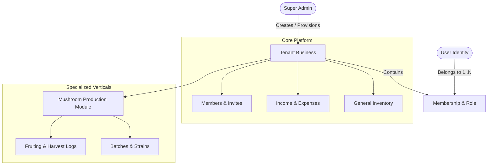

# Project Overview — BusinessHub SaaS

## 1. Product Vision & Purpose
**BusinessHub SaaS** is a modern, multi-tenant business management web application tailored for small and growing enterprises. It combines generic business management capabilities (inventory, orders, members, finances) with extensible, industry-specific operational modules. 

The first vertical module is a specialized **Mushroom Production & Cultivation Management System**, designed to handle batch lifecycles, incubation, fruiting chambers, harvesting yield logs, and quality tracking without polluting the core general-purpose business architecture.

---

## 2. Core Business Invariants & User Model

The system enforces strict multi-tenant boundaries and user authorization rules:

| Entity | Description & Cardinality Rules |
| :--- | :--- |
| **User** | A unique human account identified by a verified email. A single user can belong to multiple businesses. |
| **Business** | A tenant organization. A business can have multiple owners (configurable 1–10 owners), managers, and members. |
| **Membership** | Connects `User` to `Business` with role-based permissions (`OWNER`, `MANAGER`, `MEMBER`, etc.). |
| **Super Admin** | Platform-level administrator capable of creating businesses and assigning initial owners. |
| **Invitations** | Cryptographically signed, expiring, single-use invite links sent to verified emails. Plaintext passwords are never emailed. |
| **Tenant Isolation** | All business domain records (invoices, inventory, mushroom batches) belong to a single `businessId`. Cross-tenant querying is strictly prohibited. |

---

## 3. Product Functional Scope

### A. Core Platform (Horizontal SaaS)
1. **Authentication & Identity**: Credentials auth, session persistence, secure password hashing, self-service profile management.
2. **Multi-Tenancy & Workspace Switching**: Active tenant context selector, permissions check per tenant.
3. **Owner & Member Management**: Super Admin business creation, owner invitation flow, partner onboarding, role assignments, owner limit enforcement (1–10).
4. **General Business Modules**:
   - Inventory tracking & alerts.
   - Sales, orders, and customer management.
   - Expense logging and financial summaries.

### B. Mushroom Production Module (Vertical Extension)
The mushroom module extends the core platform cleanly via relational isolation:
- **Batch & Strain Tracking**: Spawn batches, substrate types, strain genetics.
- **Phase Management**: Substrate preparation, inoculation, incubation monitoring, fruiting chamber parameters.
- **Harvest & Yield Logging**: Flush records, yield weights, grading, scrap/waste tracking.
- **Cost Allocation**: Substrate and labor costing linked back to core finance and inventory.

---

## 4. Architectural Boundaries

---

## 5. Non-Functional & Infrastructure Goals

- **Security First**: Zero trust between tenants, secure session cookies, token hashing, input sanitization with Zod.
- **Local-First Development**: Fully functional on local development environments (Windows/macOS/Linux) with Node.js and MySQL.
- **Temporary External Testing**: Cloudflare Tunnel compatibility for ad-hoc stakeholder demos without permanent public exposure.
- **Target Hosting**: Lightweight, containerized or Node.js runtime deployment compatible with Hostinger VPS / Cloud hosting.
