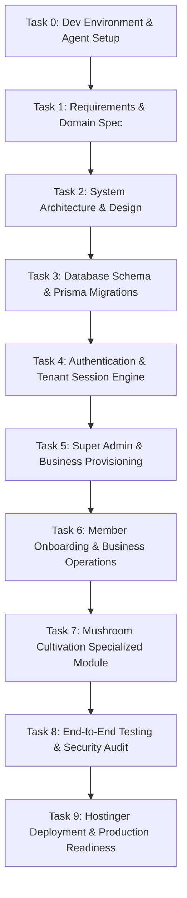

# Multi-Tenant SaaS Implementation Roadmap (Tasks 0 – 9)

This roadmap outlines the phased development sequence for **BusinessHub SaaS**. Each task builds on predecessor tasks and must satisfy its acceptance criteria before progressing.

---

## Task Summary & Dependency Graph

---

## Detailed Task Specifications

### Task 0: Master Development Environment & AI Agent Workflow Setup
- **Objective**: Establish development foundation, operating standards, Git rules, environment configs, and AI agent operating guidelines.
- **Dependencies**: None.
- **Acceptance Criteria**:
  - [x] Workspace inspected and existing assets preserved.
  - [x] `AGENTS.md` created with project invariants, security rules, and Windows execution guidance.
  - [x] `.gitignore` and `.env.example` created with secure placeholders.
  - [x] `docs/` documentation suite initialized (`PROJECT_OVERVIEW`, `DEVELOPMENT_WORKFLOW`, `TASK_ROADMAP`, `ARCHITECTURE_DECISIONS`, `AGENT_TOOLING`).
  - [x] Feature branch `feature/task-00-development-foundation` created.

---

### Task 1: Product Requirements & Domain Specification
- **Objective**: Formalize business requirements, user stories, role permissions matrix, multi-tenant owner limits (1–10), invitation lifecycle, and mushroom production domain models.
- **Dependencies**: Task 0.
- **Acceptance Criteria**:
  - [x] Detailed actor matrix: Super Admin, Business Owner, Partner, Business Manager, Member, Cultivation Tech ([USER_PERSONAS.md](file:///d:/RND/next%20js/BusinessHub-SaaS/docs/requirements/USER_PERSONAS.md), [ROLE_PERMISSION_MATRIX.md](file:///d:/RND/next%20js/BusinessHub-SaaS/docs/requirements/ROLE_PERMISSION_MATRIX.md)).
  - [x] Specification of owner limit constraints (1–10 owners enforced server-side, [BUSINESS_REQUIREMENTS.md](file:///d:/RND/next%20js/BusinessHub-SaaS/docs/requirements/BUSINESS_REQUIREMENTS.md)).
  - [x] Step-by-step invitation flow with single-use, expiring setup links ([BUSINESS_WORKFLOWS.md](file:///d:/RND/next%20js/BusinessHub-SaaS/docs/requirements/BUSINESS_WORKFLOWS.md), [USER_STORIES.md](file:///d:/RND/next%20js/BusinessHub-SaaS/docs/requirements/USER_STORIES.md)).
  - [x] Domain glossary and entity relationships for both core business and mushroom module ([BUSINESS_REQUIREMENTS.md](file:///d:/RND/next%20js/BusinessHub-SaaS/docs/requirements/BUSINESS_REQUIREMENTS.md), [MVP_SCOPE.md](file:///d:/RND/next%20js/BusinessHub-SaaS/docs/requirements/MVP_SCOPE.md)).
  - [x] Reference analysis for Odoo, Zoho Books, ERPNext, and Next.js evals ([REFERENCE_ANALYSIS.md](file:///d:/RND/next%20js/BusinessHub-SaaS/docs/requirements/REFERENCE_ANALYSIS.md)).
  - [x] Measurable non-functional requirements and testing benchmarks ([NON_FUNCTIONAL_REQUIREMENTS.md](file:///d:/RND/next%20js/BusinessHub-SaaS/docs/requirements/NON_FUNCTIONAL_REQUIREMENTS.md)).
  - [x] Accounting governance decisions and open questions with recommended defaults ([OPEN_QUESTIONS.md](file:///d:/RND/next%20js/BusinessHub-SaaS/docs/requirements/OPEN_QUESTIONS.md)).

---

### Task 2: System Architecture & Technical Design
- **Objective**: Design Next.js App Router directory structure, component hierarchy, server actions/service patterns, Zod validation pipelines, and Hostinger deployment strategy.
- **Dependencies**: Task 1.
- **Acceptance Criteria**:
  - [x] Project directory layout specified (`app/`, `components/`, `lib/`, `prisma/`, `modules/`, `types/`) ([NEXTJS_PROJECT_STRUCTURE.md](file:///d:/RND/next%20js/BusinessHub-SaaS/docs/architecture/NEXTJS_PROJECT_STRUCTURE.md)).
  - [x] Strict tenant boundary pattern defined (server-side context extraction, data isolation) ([TENANT_ISOLATION.md](file:///d:/RND/next%20js/BusinessHub-SaaS/docs/architecture/TENANT_ISOLATION.md)).
  - [x] Complete relational database ERD and canonical Prisma schema ([DATABASE_ERD.md](file:///d:/RND/next%20js/BusinessHub-SaaS/docs/architecture/DATABASE_ERD.md), [schema.prisma](file:///d:/RND/next%20js/BusinessHub-SaaS/prisma/schema.prisma)).
  - [x] Concurrency-safe 1–10 owner limit locking strategy documented ([TENANT_ISOLATION.md](file:///d:/RND/next%20js/BusinessHub-SaaS/docs/architecture/TENANT_ISOLATION.md)).
  - [x] Safe Prisma migration and Hostinger deployment roadmap ([DATABASE_MIGRATION_STRATEGY.md](file:///d:/RND/next%20js/BusinessHub-SaaS/docs/architecture/DATABASE_MIGRATION_STRATEGY.md)).
  - [x] 6-step reusable authorization pipeline and security boundaries ([SECURITY_ARCHITECTURE.md](file:///d:/RND/next%20js/BusinessHub-SaaS/docs/architecture/SECURITY_ARCHITECTURE.md)).
  - [x] Formal Architecture Decision Records ADR 01–10 ([ARCHITECTURE_DECISIONS.md](file:///d:/RND/next%20js/BusinessHub-SaaS/docs/architecture/ARCHITECTURE_DECISIONS.md)).

---

### Task 3: Authentication & Access Control
- **Objective**: Implement secure authentication, password hashing, session management, multi-tenant authorization guards, and cryptographic single-use invitation lifecycle.
- **Dependencies**: Task 2.
- **Acceptance Criteria**:
  - [x] Initial database migration executed against MySQL (`20261017172830_init_auth_and_access_control`).
  - [x] Password hashing with bcrypt (work factor 12) and password complexity validation (`lib/auth/password.ts`).
  - [x] 256-bit cryptographic token generation with SHA-256 database storage (`lib/auth/tokens.ts`).
  - [x] Tamper-proof encrypted JWT session cookies with HttpOnly and SameSite (`lib/auth/session.ts`).
  - [x] Multi-tenant context extraction and server-side membership verification (`lib/tenant/context.ts`).
  - [x] Role-permission matrix evaluation and reusable Server Action guards (`lib/tenant/guards.ts`).
  - [x] Concurrency-safe 1–10 owner quota enforcement with row-locking (`modules/core-tenancy/services/ownerQuota.service.ts`).
  - [x] Cryptographic single-use invitation onboarding with 48h TTL (`modules/core-tenancy/services/invitation.service.ts`).
  - [x] Interactive authentication UI (Sign In, Password Recovery, Invitation Acceptance, Tenant Switcher).
  - [x] 26 automated unit and database integration tests executed and passing (`tests/`).

### Task 4: Core Business & Partner Management
- **Objective**: Implement business lifecycle, settings management, partner & member role management, last-owner protection, 1-10 owner limit, and tenant activity audit logging.
- **Dependencies**: Task 3.
- **Acceptance Criteria**:
  - [x] Super Admin business tenant provisioning with unique slug generation and initial owner assignment (`modules/core-tenancy/services/business.service.ts`).
  - [x] Business settings management (currency, timezone, contact info, financial approval thresholds) with migration `20261017174149_add_business_settings_fields`.
  - [x] Strict 1–10 owner quota enforcement inside database transactions (`assertOwnerQuotaAvailable`).
  - [x] Minimum 1 active owner protection preventing removal or demotion of last owner (`assertNotLastOwner`).
  - [x] Partner & staff invitations with role-scoped permission checks and revocation.
  - [x] Member management: role updates, equity percentage, profit share percentage, and revocation.
  - [x] Tenant-isolated activity history audit log viewing (`/activity`).
  - [x] Responsive Next.js App Router UI pages (`/`, `/businesses`, `/businesses/new`, `/settings`, `/members`, `/activity`).
  - [x] 35 automated tests passing with zero TypeScript errors and successful production build.

---

### Task 5: Finance & Profit-Sharing Module
- **Objective**: Implement multi-tenant financial ledgers, income & expense tracking with dual approvals, partner capital contributions, partner loans, configurable profit/loss sharing rules, and period closing.
- **Dependencies**: Task 4.
- **Acceptance Criteria**:
  - [x] Dual-approval income & expense tracking with category classification and approval threshold (`modules/finance/services/transaction.service.ts`).
  - [x] Partner capital contribution ledger and partner drawing requests with co-owner sign-off (`modules/finance/services/capital.service.ts`).
  - [x] Partner position balance sheets calculating net position: `(capital + distributions) - drawings`.
  - [x] Partner & business loan agreements with amortized repayments separating principal and interest (`modules/finance/services/loan.service.ts`).
  - [x] Configurable, versioned profit/loss-sharing rules supporting custom %, equal split, capital-based, and loss policies (`modules/finance/services/profitSharing.service.ts`).
  - [x] Deterministic decimal-safe allocation calculator with integer cent remainder distribution (`modules/finance/utils/decimal.ts`).
  - [x] Period closing engine locking historical transactions and generating immutable distribution snapshots.
  - [x] Responsive Next.js App Router UI pages (`/finance`, `/finance/transactions`, `/finance/capital`, `/finance/loans`, `/finance/profit-sharing`).
  - [x] Database migration `20261017180619_add_finance_and_profit_sharing` applied to MySQL.
  - [x] 48 automated tests passing across 8 suites with successful production build.

---

### Task 6: Member Onboarding & Business Operations
- **Objective**: Implement owner/partner invitation flows, member permission assignment, and core business management foundations (inventory/finances).
- **Dependencies**: Task 5.
- **Acceptance Criteria**:
  - Business owners can invite partners/managers up to configured owner limit.
  - Single-use invite token lifecycle (48-hour expiration, token invalidation on consume).
  - Member management table with role assignment and removal.
  - Basic inventory item and expense/income logging foundation.

---

### Task 7: Specialized Mushroom Production Module
- **Objective**: Build the dedicated mushroom cultivation module with batch lifecycle tracking.
- **Dependencies**: Task 6.
- **Acceptance Criteria**:
  - Batch creation: strain genetics, substrate mix, inoculation date.
  - Incubation monitoring & environmental condition logging.
  - Fruiting chamber allocation and flush/harvest logging (weight, grade, waste).
  - Linked consumption to core inventory (spawn, substrate materials).

---

### Task 8: End-to-End Testing & Security Audit
- **Objective**: Implement automated unit, integration, and E2E browser tests to verify cross-tenant data isolation and workflows.
- **Dependencies**: Task 7.
- **Acceptance Criteria**:
  - Multi-tenancy leak test: Verify user from Business A cannot read/mutate Business B records.
  - Complete E2E flow: Super Admin creates business -> Owner receives link -> Owner sets password -> Invites partner -> Partner accepts.
  - Zero critical security vulnerabilities in dependency scan (`npm audit`).

---

### Task 9: Hostinger Deployment & Production Readiness
- **Objective**: Finalize production build, Docker / PM2 configuration for Hostinger VPS, reverse proxy setup, and migration scripts.
- **Dependencies**: Task 8.
- **Acceptance Criteria**:
  - Production build succeeds cleanly (`npm run build`).
  - Standalone Node.js output or Dockerfile verified.
  - Hostinger deployment guide with MySQL setup, environment variable management, and automated backup recommendations.
