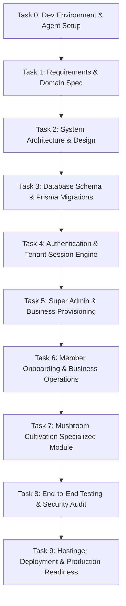

# Multi-Tenant SaaS Implementation Roadmap (Tasks 0 – 9)

This roadmap outlines the phased development sequence for **BusinessHub SaaS**. Each task builds on predecessor tasks and must satisfy its acceptance criteria before progressing.

---

## Task Summary & Dependency Graph

---

## Detailed Task Specifications

### Task 0: Master Development Environment & AI Agent Workflow Setup
- **Objective**: Establish development foundation, operating standards, Git rules, environment configs, and AI agent operating guidelines.
- **Dependencies**: None.
- **Acceptance Criteria**:
  - [x] Workspace inspected and existing assets preserved.
  - [x] `AGENTS.md` created with project invariants, security rules, and Windows execution guidance.
  - [x] `.gitignore` and `.env.example` created with secure placeholders.
  - [x] `docs/` documentation suite initialized (`PROJECT_OVERVIEW`, `DEVELOPMENT_WORKFLOW`, `TASK_ROADMAP`, `ARCHITECTURE_DECISIONS`, `AGENT_TOOLING`).
  - [x] Feature branch `feature/task-00-development-foundation` created.

---

### Task 1: Product Requirements & Domain Specification
- **Objective**: Formalize business requirements, user stories, role permissions matrix, multi-tenant owner limits (1–10), invitation lifecycle, and mushroom production domain models.
- **Dependencies**: Task 0.
- **Acceptance Criteria**:
  - [x] Detailed actor matrix: Super Admin, Business Owner, Partner, Business Manager, Member, Cultivation Tech ([USER_PERSONAS.md](file:///d:/RND/next%20js/BusinessHub-SaaS/docs/requirements/USER_PERSONAS.md), [ROLE_PERMISSION_MATRIX.md](file:///d:/RND/next%20js/BusinessHub-SaaS/docs/requirements/ROLE_PERMISSION_MATRIX.md)).
  - [x] Specification of owner limit constraints (1–10 owners enforced server-side, [BUSINESS_REQUIREMENTS.md](file:///d:/RND/next%20js/BusinessHub-SaaS/docs/requirements/BUSINESS_REQUIREMENTS.md)).
  - [x] Step-by-step invitation flow with single-use, expiring setup links ([BUSINESS_WORKFLOWS.md](file:///d:/RND/next%20js/BusinessHub-SaaS/docs/requirements/BUSINESS_WORKFLOWS.md), [USER_STORIES.md](file:///d:/RND/next%20js/BusinessHub-SaaS/docs/requirements/USER_STORIES.md)).
  - [x] Domain glossary and entity relationships for both core business and mushroom module ([BUSINESS_REQUIREMENTS.md](file:///d:/RND/next%20js/BusinessHub-SaaS/docs/requirements/BUSINESS_REQUIREMENTS.md), [MVP_SCOPE.md](file:///d:/RND/next%20js/BusinessHub-SaaS/docs/requirements/MVP_SCOPE.md)).
  - [x] Reference analysis for Odoo, Zoho Books, ERPNext, and Next.js evals ([REFERENCE_ANALYSIS.md](file:///d:/RND/next%20js/BusinessHub-SaaS/docs/requirements/REFERENCE_ANALYSIS.md)).
  - [x] Measurable non-functional requirements and testing benchmarks ([NON_FUNCTIONAL_REQUIREMENTS.md](file:///d:/RND/next%20js/BusinessHub-SaaS/docs/requirements/NON_FUNCTIONAL_REQUIREMENTS.md)).
  - [x] Accounting governance decisions and open questions with recommended defaults ([OPEN_QUESTIONS.md](file:///d:/RND/next%20js/BusinessHub-SaaS/docs/requirements/OPEN_QUESTIONS.md)).

---

### Task 2: System Architecture & Technical Design
- **Objective**: Design Next.js App Router directory structure, component hierarchy, server actions/service patterns, Zod validation pipelines, and Hostinger deployment strategy.
- **Dependencies**: Task 1.
- **Acceptance Criteria**:
  - [x] Project directory layout specified (`app/`, `components/`, `lib/`, `prisma/`, `modules/`, `types/`) ([NEXTJS_PROJECT_STRUCTURE.md](file:///d:/RND/next%20js/BusinessHub-SaaS/docs/architecture/NEXTJS_PROJECT_STRUCTURE.md)).
  - [x] Strict tenant boundary pattern defined (server-side context extraction, data isolation) ([TENANT_ISOLATION.md](file:///d:/RND/next%20js/BusinessHub-SaaS/docs/architecture/TENANT_ISOLATION.md)).
  - [x] Complete relational database ERD and canonical Prisma schema ([DATABASE_ERD.md](file:///d:/RND/next%20js/BusinessHub-SaaS/docs/architecture/DATABASE_ERD.md), [schema.prisma](file:///d:/RND/next%20js/BusinessHub-SaaS/prisma/schema.prisma)).
  - [x] Concurrency-safe 1–10 owner limit locking strategy documented ([TENANT_ISOLATION.md](file:///d:/RND/next%20js/BusinessHub-SaaS/docs/architecture/TENANT_ISOLATION.md)).
  - [x] Safe Prisma migration and Hostinger deployment roadmap ([DATABASE_MIGRATION_STRATEGY.md](file:///d:/RND/next%20js/BusinessHub-SaaS/docs/architecture/DATABASE_MIGRATION_STRATEGY.md)).
  - [x] 6-step reusable authorization pipeline and security boundaries ([SECURITY_ARCHITECTURE.md](file:///d:/RND/next%20js/BusinessHub-SaaS/docs/architecture/SECURITY_ARCHITECTURE.md)).
  - [x] Formal Architecture Decision Records ADR 01–10 ([ARCHITECTURE_DECISIONS.md](file:///d:/RND/next%20js/BusinessHub-SaaS/docs/architecture/ARCHITECTURE_DECISIONS.md)).

---

### Task 3: Database Schema & Migration Foundation
- **Objective**: Implement Prisma ORM schema for MySQL, seed script, and migration runner.
- **Dependencies**: Task 2.
- **Acceptance Criteria**:
  - Models created: `User`, `Account`, `Session`, `Business`, `Membership`, `Role`, `InvitationToken`, `AuditLog`.
  - Extension models created: `MushroomBatch`, `SubstrateMix`, `FruitingChamber`, `HarvestLog`.
  - Database relations and indexes optimized for tenant-scoped querying (`@@index([businessId])`).
  - Seed script populating baseline roles, initial test super admin, and test business.

---

### Task 4: Secure Authentication & Tenant Session Engine
- **Objective**: Implement user authentication, password hashing, session management, and active business context switching.
- **Dependencies**: Task 3.
- **Acceptance Criteria**:
  - Secure credential login with bcrypt/argon2 hashing.
  - Multi-business user context: users can switch between their authorized businesses.
  - Session contains user identity; active tenant validated server-side on every request.
  - Expiring, single-use account setup / password creation token verification.

---

### Task 5: Platform Super Admin & Business Provisioning
- **Objective**: Build platform administration interface for Super Admins to create businesses and assign initial owners.
- **Dependencies**: Task 4.
- **Acceptance Criteria**:
  - Super Admin dashboard protected by platform-level authorization guard.
  - Create business form with name, slug, owner limit (1–10), and primary owner email.
  - Dispatches invitation setup link to the new owner.
  - Audit logging of business creation events.

---

### Task 6: Member Onboarding & Business Operations
- **Objective**: Implement owner/partner invitation flows, member permission assignment, and core business management foundations (inventory/finances).
- **Dependencies**: Task 5.
- **Acceptance Criteria**:
  - Business owners can invite partners/managers up to configured owner limit.
  - Single-use invite token lifecycle (48-hour expiration, token invalidation on consume).
  - Member management table with role assignment and removal.
  - Basic inventory item and expense/income logging foundation.

---

### Task 7: Specialized Mushroom Production Module
- **Objective**: Build the dedicated mushroom cultivation module with batch lifecycle tracking.
- **Dependencies**: Task 6.
- **Acceptance Criteria**:
  - Batch creation: strain genetics, substrate mix, inoculation date.
  - Incubation monitoring & environmental condition logging.
  - Fruiting chamber allocation and flush/harvest logging (weight, grade, waste).
  - Linked consumption to core inventory (spawn, substrate materials).

---

### Task 8: End-to-End Testing & Security Audit
- **Objective**: Implement automated unit, integration, and E2E browser tests to verify cross-tenant data isolation and workflows.
- **Dependencies**: Task 7.
- **Acceptance Criteria**:
  - Multi-tenancy leak test: Verify user from Business A cannot read/mutate Business B records.
  - Complete E2E flow: Super Admin creates business -> Owner receives link -> Owner sets password -> Invites partner -> Partner accepts.
  - Zero critical security vulnerabilities in dependency scan (`npm audit`).

---

### Task 9: Hostinger Deployment & Production Readiness
- **Objective**: Finalize production build, Docker / PM2 configuration for Hostinger VPS, reverse proxy setup, and migration scripts.
- **Dependencies**: Task 8.
- **Acceptance Criteria**:
  - Production build succeeds cleanly (`npm run build`).
  - Standalone Node.js output or Dockerfile verified.
  - Hostinger deployment guide with MySQL setup, environment variable management, and automated backup recommendations.
