# Database Entity-Relationship Diagram (ERD) — BusinessHub SaaS

This document specifies the relational database schema, primary/foreign key cardinalities, data types, and referential integrity constraints for **BusinessHub SaaS**.

---

## 1. Complete Entity-Relationship Diagram (ERD)

```mermaid
erDiagram
    User ||--o{ BusinessMembership : "holds 1..N"
    User ||--o{ InvitationToken : "created_by"
    User ||--o{ AuditEvent : "acted_in"
    User ||--o{ FinancialTransaction : "created_by"
    User ||--o{ ProductionBatch : "initiated_by"
    User ||--o{ HarvestLog : "harvested_by"

    Business ||--|{ BusinessMembership : "has 1..N members"
    Business ||--|| BusinessSettings : "configured_by"
    Business ||--o{ InvitationToken : "issues"
    Business ||--o{ AuditEvent : "owns"
    Business ||--o{ FinancialTransaction : "records"
    Business ||--o{ TransactionCategory : "defines"
    Business ||--o{ PartnerCapitalContribution : "receives"
    Business ||--o{ PartnerLoan : "incurs"
    Business ||--o{ PartnerDrawing : "disburses"
    Business ||--o{ ClosedPeriod : "closes"
    Business ||--o{ Product : "catalogs"
    Business ||--o{ StockMovement : "tracks"
    Business ||--o{ Customer : "serves"
    Business ||--o{ Supplier : "purchases_from"
    Business ||--o{ Order : "processes"
    Business ||--o{ MushroomStrain : "cultivates"
    Business ||--o{ SubstrateRecipe : "formulates"
    Business ||--o{ FruitingChamber : "maintains"
    Business ||--o{ ProductionBatch : "operates"
    Business ||--o{ DryingRun : "processes"

    ClosedPeriod ||--o{ ProfitDistribution : "allocates"
    BusinessMembership ||--o{ ProfitDistribution : "receives"
    BusinessMembership ||--o{ PartnerCapitalContribution : "contributes"
    BusinessMembership ||--o{ PartnerLoan : "loans"
    BusinessMembership ||--o{ PartnerDrawing : "requests"

    FinancialTransaction }o--|| TransactionCategory : "categorized_by"
    FinancialTransaction }o--o| Order : "settles"

    Order ||--|{ OrderItem : "contains"
    OrderItem }o--|| Product : "references"
    Order }o--|| Customer : "billed_to"

    Product ||--o{ StockMovement : "logs"

    SubstrateRecipe ||--|{ RecipeIngredient : "requires"
    RecipeIngredient }o--|| Product : "raw_material"
    SubstrateRecipe }o--|| MushroomStrain : "targets"

    ProductionBatch }o--|| MushroomStrain : "uses_genetics"
    ProductionBatch }o--|| SubstrateRecipe : "formulated_with"
    ProductionBatch }o--o| FruitingChamber : "occupies"
    ProductionBatch ||--o{ PhaseLog : "advances_through"
    ProductionBatch ||--o{ HarvestLog : "yields"
    ProductionBatch ||--o{ ContaminationLog : "discards"

    HarvestLog }o--|| Product : "increments_fresh_stock"
    DryingRun }o--|| Product : "consumes_fresh_stock"
    DryingRun }o--|| Product : "yields_dried_stock"

    User {
        string id PK
        string email UK
        string passwordHash
        string fullName
        string phone
        boolean isSuperAdmin
        datetime createdAt
        datetime updatedAt
    }

    Business {
        string id PK
        string name
        string slug UK
        string status
        int maxOwners "Default 10"
        datetime createdAt
        datetime updatedAt
    }

    BusinessMembership {
        string id PK
        string businessId FK
        string userId FK
        string role "OWNER, PARTNER_FINANCE, PARTNER_OPS, STAFF, VIEWER"
        string status "ACTIVE, INACTIVE, REVOKED"
        decimal equityPercentage "Decimal 5,2"
        decimal profitSharePercentage "Decimal 5,2"
        datetime joinedAt
        datetime updatedAt
    }

    BusinessSettings {
        string id PK
        string businessId FK, UK
        string currency "e.g. LKR, USD"
        decimal expenseApprovalThreshold "Decimal 12,2"
        int defaultReservePercentage "e.g. 20"
        boolean autoDeductInventory
        datetime updatedAt
    }

    InvitationToken {
        string id PK
        string businessId FK
        string email
        string tokenHash UK "SHA-256"
        string role
        decimal proposedEquity "Optional"
        decimal proposedProfitShare "Optional"
        string status "PENDING, CONSUMED, EXPIRED, REVOKED"
        datetime expiresAt
        datetime createdAt
    }

    FinancialTransaction {
        string id PK
        string businessId FK
        string categoryId FK
        string type "INCOME, EXPENSE"
        decimal amount "Decimal 12,2"
        string paymentMethod "CASH, BANK_TRANSFER, CARD"
        string description
        string receiptUrl "Optional"
        string approvalStatus "ACTIVE, PENDING_APPROVAL, REJECTED"
        string approvedById FK "Optional"
        datetime transactionDate
        datetime createdAt
    }

    PartnerCapitalContribution {
        string id PK
        string businessId FK
        string membershipId FK
        decimal amount "Decimal 12,2"
        string paymentReference
        datetime contributionDate
        datetime createdAt
    }

    PartnerLoan {
        string id PK
        string businessId FK
        string membershipId FK
        decimal principalAmount "Decimal 12,2"
        decimal annualInterestRate "Decimal 5,2"
        decimal outstandingBalance "Decimal 12,2"
        datetime startDate
        datetime maturityDate
        string status "ACTIVE, REPAID, DEFAULTED"
    }

    PartnerDrawing {
        string id PK
        string businessId FK
        string membershipId FK
        decimal amount "Decimal 12,2"
        string status "PENDING, APPROVED, REJECTED"
        string approvedById FK "Optional"
        datetime requestDate
    }

    ClosedPeriod {
        string id PK
        string businessId FK
        datetime startDate
        datetime endDate
        decimal totalIncome "Decimal 12,2"
        decimal totalExpense "Decimal 12,2"
        decimal netProfit "Decimal 12,2"
        decimal retainedReserve "Decimal 12,2"
        decimal distributedAmount "Decimal 12,2"
        string closedById FK
        datetime closedAt
    }

    ProfitDistribution {
        string id PK
        string closedPeriodId FK
        string membershipId FK
        decimal profitSharePercentage "Decimal 5,2"
        decimal allocatedAmount "Decimal 12,2"
        datetime distributedAt
    }

    Product {
        string id PK
        string businessId FK
        string sku
        string name
        string category "RAW_MATERIAL, PACKAGING, FRESH_MUSHROOM, DRIED_MUSHROOM"
        string unitOfMeasure "KG, GRAM, BAG, PIECE, LITER"
        decimal currentStock "Decimal 12,3"
        decimal unitCost "Decimal 12,2"
        decimal sellingPrice "Decimal 12,2"
        decimal reorderThreshold "Decimal 12,3"
    }

    StockMovement {
        string id PK
        string businessId FK
        string productId FK
        string type "PURCHASE_RECEIPT, PRODUCTION_CONSUMPTION, PRODUCTION_YIELD, SALE_DISPATCH, ADJUSTMENT_SCRAP"
        decimal quantity "Decimal 12,3"
        decimal balanceAfter "Decimal 12,3"
        string referenceId "Optional OrderID or BatchID"
        string notes
        datetime createdAt
    }

    MushroomStrain {
        string id PK
        string businessId FK
        string name "e.g. Grey Oyster"
        string scientificName "Pleurotus ostreatus"
        string idealTempRange "e.g. 20-25C"
        string idealHumidityRange "e.g. 85-95%"
    }

    SubstrateRecipe {
        string id PK
        string businessId FK
        string strainId FK
        string name "e.g. Standard Sawdust 1kg Bag"
        decimal standardBagWeightKg "Decimal 6,3"
        string description
    }

    RecipeIngredient {
        string id PK
        string recipeId FK
        string rawMaterialProductId FK
        decimal percentage "Decimal 5,2"
        decimal quantityPerBag "Decimal 8,4"
    }

    FruitingChamber {
        string id PK
        string businessId FK
        string name "e.g. Chamber A"
        int capacityBags
        string currentStatus "ACTIVE, CLEANING, EMPTY"
    }

    ProductionBatch {
        string id PK
        string businessId FK
        string batchCode UK
        string strainId FK
        string recipeId FK
        string chamberId FK "Optional"
        int initialBagsPrepared
        int viableBagsCount
        string currentPhase "PREPARATION, STERILIZATION, INOCULATION, INCUBATION, FRUITING, COMPLETED, TERMINATED"
        datetime startDate
        datetime completedDate "Optional"
    }

    HarvestLog {
        string id PK
        string businessId FK
        string batchId FK
        string freshProductId FK
        int flushNumber "1, 2, 3"
        decimal freshWeightKg "Decimal 10,3"
        decimal gradeAWeightKg "Decimal 10,3"
        decimal gradeBWeightKg "Decimal 10,3"
        decimal scrapWeightKg "Decimal 10,3"
        datetime harvestDate
    }

    ContaminationLog {
        string id PK
        string businessId FK
        string batchId FK
        string phaseDetected
        int discardedBagsCount
        string reason "GREEN_MOLD, COBWEB, BACTERIAL_BLOTCH, PESTS, UNKNOWN"
        datetime loggedAt
    }

    DryingRun {
        string id PK
        string businessId FK
        string freshProductId FK
        string driedProductId FK
        decimal freshWeightInKg "Decimal 10,3"
        decimal driedWeightOutKg "Decimal 10,3"
        decimal moistureLossPercentage "Decimal 5,2"
        datetime startedAt
        datetime completedAt
    }

    AuditEvent {
        string id PK
        string businessId FK "Optional for platform logs"
        string userId FK "Optional"
        string actionType
        string targetEntity
        string targetId
        string clientIp
        json changeDetails
        datetime timestamp
    }
```

---

## 2. Referential Integrity & Cascade Deletion Policy

To guarantee business and financial integrity, cascading deletes are strictly regulated:

| Relationship | Referential Action | Business Rationale |
| :--- | :--- | :--- |
| `Business -> BusinessMembership` | `onDelete: Cascade` | Removing a tenant wipes membership links. |
| `Business -> FinancialTransaction` | `onDelete: Restrict` | Prevents deleting a business with existing audited financial records. |
| `Business -> Product` | `onDelete: Restrict` | Catalog cannot be dropped if stock movement history exists. |
| `Product -> StockMovement` | `onDelete: Restrict` | Products cannot be deleted if historical inventory ledger movements exist. |
| `ProductionBatch -> HarvestLog` | `onDelete: Restrict` | Batches with registered harvests cannot be deleted (must be marked `COMPLETED` or `TERMINATED`). |
| `ProductionBatch -> ContaminationLog` | `onDelete: Cascade` | Discard logs are tied directly to the batch lifecycle. |
| `ClosedPeriod -> ProfitDistribution` | `onDelete: Restrict` | Finalized dividend distribution statements are permanently locked. |

---

## 3. Precision & Unit Representation Standards

- **Monetary Amounts**: Stored strictly as **`Decimal(12, 2)`** (e.g., `999,999,999.99`). Floating-point numbers (`Float`, `Double`) are strictly prohibited to prevent decimal rounding discrepancies.
- **Agricultural Weights (Kilograms)**: Stored as **`Decimal(10, 3)`** or **`Decimal(12, 3)`** providing precision down to the exact gram (e.g., `12.450 kg`).
- **Percentages & Ratios**: Stored as **`Decimal(5, 2)`** (e.g., `33.33%`, `100.00%`).
- **Timestamps**: All timestamps stored in database as UTC `DateTime(3)` with millisecond precision. Local timezone presentation is formatted client-side.
