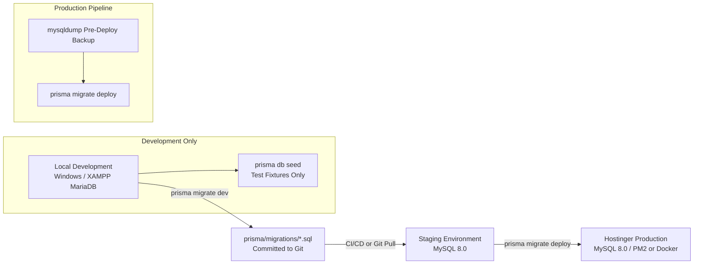

# Database Migration & Deployment Strategy — BusinessHub SaaS

This document establishes the official database migration, versioning, backup, and deployment protocols for **BusinessHub SaaS**.

---

## 1. Environment Segmentation & Tooling Matrix



| Lifecycle Phase | Command | Permitted Environments | Guardrails & Restrictions |
| :--- | :--- | :--- | :--- |
| **New Migration** | `npx prisma migrate dev --name <name>` | Local Development Only | Generates new timestamped SQL directory in `prisma/migrations/`. Inspect SQL before committing. |
| **Apply Existing**| `npx prisma migrate deploy` | Staging, Hostinger Production | Applies unapplied migrations idempotently. Does NOT modify schema or create migrations. |
| **Seed Database** | `npx prisma db seed` | Local Development, Staging | Seeds baseline roles and test fixtures. Forbidden in live production. |
| **Schema Validation** | `npx prisma validate` | All Environments & CI/CD | Validates syntax, relations, and type safety without touching database data. |

> [!CAUTION]
> **Prohibited Commands**:
> - `npx prisma migrate reset`: Destroys the database and all data. Strictly prohibited in staging and production.
> - `npx prisma db push --force-reset`: Bypasses migration tracking and truncates tables. Strictly prohibited.

---

## 2. Local Development Workflow (Windows & XAMPP)

1. **Verify Local MySQL Running**:
   - Ensure XAMPP MySQL / MariaDB service is active on `127.0.0.1:3306`.
   - Ensure `.env.local` points to `businesshub_dev`:
     ```env
     DATABASE_URL="mysql://root:@127.0.0.1:3306/businesshub_dev"
     ```
2. **Execute Migration**:
   ```powershell
   cmd.exe /c npx prisma migrate dev --name <descriptive_name>
   ```
3. **Inspect Generated SQL**:
   - Always open and review `prisma/migrations/<timestamp>_<descriptive_name>/migration.sql` to verify table definitions, foreign keys, and indexes.

---

## 3. Hostinger Production Deployment Routine

Prior to applying migrations on the Hostinger VPS or Cloud environment:

### Step 1: Pre-Migration Backup (Automated / Manual)
```bash
# Generate timestamped database dump before applying any migration
TIMESTAMP=$(date +"%Y%m%d_%H%M%S")
mysqldump -u businesshub_user -p businesshub_prod > /var/backups/db/businesshub_prod_pre_${TIMESTAMP}.sql
```

### Step 2: Apply Reviewed Migrations
```bash
# Execute only approved, version-controlled migrations
npx prisma migrate deploy
```

### Step 3: Health & Smoke Verification
- Call `/api/health` to confirm database connectivity.
- Verify existing tenant login and session validation.

---

## 4. Roll-Forward Strategy for Migration Recovery

Database schema rollbacks in production carry high risk of data corruption. BusinessHub SaaS enforces a **Roll-Forward Policy**:

1. **Never Delete Migration Files from Git**: Once a migration SQL file is committed to `main` and executed on production, it is permanently immutable.
2. **Reversible Fixes via New Migrations**:
   - If an applied migration introduces a faulty constraint or index, generate a compensatory forward migration:
     ```powershell
     npx prisma migrate dev --name fix_erroneous_index
     ```
   - Commit the new migration to Git and deploy via `prisma migrate deploy`.
3. **Emergency Restore from Backup**:
   - In the event of catastrophic data corruption or unexpected table drop, restore the pre-migration dump:
     ```bash
     mysql -u businesshub_user -p businesshub_prod < /var/backups/db/businesshub_prod_pre_*.sql
     ```

---

## 5. Idempotent Database Seeding Guidelines

The seed script (`prisma/seed.ts`) must adhere to strict security invariants:
1. **Zero Production PII**: Test users and fictitious business names only (e.g., `demo@businesshub.local`, `demo-mushrooms`).
2. **Idempotent Upserts**: All seed operations must use `prisma.model.upsert({ where: { ... }, update: {}, create: { ... } })` so executing the seed multiple times produces identical state without duplicate errors.
3. **Separation from Production Deployments**: The build and deployment script must **never** invoke `prisma db seed` automatically on production servers.
