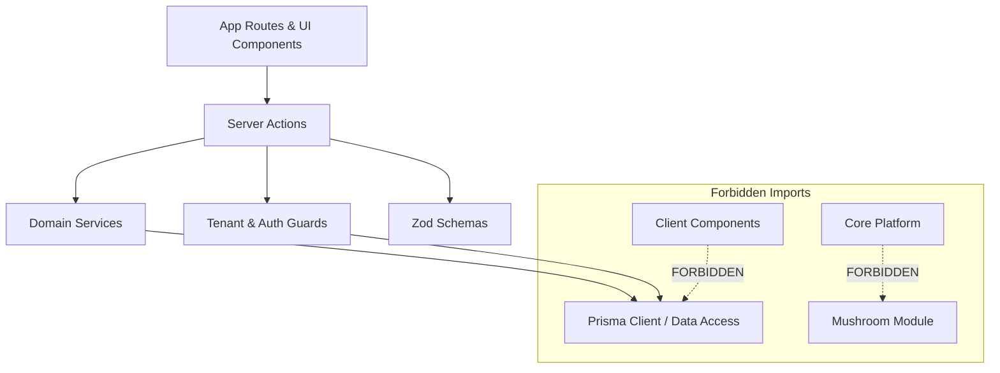

# Next.js App Router Project Structure — BusinessHub SaaS

This document establishes the official filesystem layout, module boundaries, naming standards, and dependency rules for **BusinessHub SaaS**.

---

## 1. Directory Tree Overview

```text
BusinessHub-SaaS/
├── app/                                # Next.js App Router root
│   ├── (auth)/                         # Public authentication route group (clean layout)
│   │   ├── login/
│   │   │   └── page.tsx
│   │   ├── forgot-password/
│   │   │   └── page.tsx
│   │   ├── reset-password/
│   │   │   └── [token]/
│   │   │       └── page.tsx
│   │   ├── invite/
│   │   │   └── [token]/
│   │   │       └── page.tsx
│   │   └── layout.tsx
│   │
│   ├── (admin)/                        # Platform Super Admin route group
│   │   ├── admin/
│   │   │   ├── businesses/
│   │   │   │   ├── new/
│   │   │   │   │   └── page.tsx        # Business provisioning form
│   │   │   │   ├── [id]/
│   │   │   │   │   └── page.tsx
│   │   │   │   └── page.tsx
│   │   │   ├── audit-logs/
│   │   │   │   └── page.tsx
│   │   │   └── page.tsx                # Admin overview dashboard
│   │   └── layout.tsx
│   │
│   ├── (workspace)/                    # Protected tenant business workspace
│   │   ├── dashboard/
│   │   │   └── page.tsx
│   │   ├── finance/
│   │   │   ├── transactions/
│   │   │   │   └── page.tsx
│   │   │   ├── approvals/
│   │   │   │   └── page.tsx
│   │   │   ├── partners/
│   │   │   │   └── page.tsx
│   │   │   └── closing/
│   │   │       └── page.tsx
│   │   ├── inventory/
│   │   │   ├── products/
│   │   │   │   └── page.tsx
│   │   │   └── movements/
│   │   │       └── page.tsx
│   │   ├── sales/
│   │   │   └── orders/
│   │   │       └── page.tsx
│   │   ├── mushroom/                   # Specialized mushroom cultivation module
│   │   │   ├── recipes/
│   │   │   │   └── page.tsx
│   │   │   ├── batches/
│   │   │   │   ├── [id]/
│   │   │   │   │   └── page.tsx
│   │   │   │   └── page.tsx
│   │   │   ├── harvests/
│   │   │   │   └── page.tsx
│   │   │   ├── waste/
│   │   │   │   └── page.tsx
│   │   │   ├── drying/
│   │   │   │   └── page.tsx
│   │   │   └── page.tsx                # Cultivation dashboard
│   │   ├── settings/
│   │   │   ├── members/
│   │   │   │   └── page.tsx
│   │   │   ├── profile/
│   │   │   │   └── page.tsx
│   │   │   └── audit-logs/
│   │   │       └── page.tsx
│   │   └── layout.tsx                  # Workspace layout (TopNav, TenantSwitcher, SideNav)
│   │
│   ├── api/                            # Specialized Route Handlers
│   │   ├── health/
│   │   │   └── route.ts                # Hostinger uptime check
│   │   └── exports/
│   │       └── [reportType]/
│   │           └── route.ts            # CSV / PDF streaming
│   ├── globals.css
│   ├── layout.tsx                      # Root HTML shell
│   └── page.tsx                        # Root redirect -> /login or /dashboard
│
├── components/                         # React UI Components
│   ├── ui/                             # shadcn/ui primitive library (Button, Modal, Input)
│   │   ├── button.tsx
│   │   ├── dialog.tsx
│   │   ├── dropdown-menu.tsx
│   │   ├── input.tsx
│   │   ├── table.tsx
│   │   └── toast.tsx
│   └── shared/                         # Reusable cross-module layout components
│       ├── tenant-switcher.tsx         # Multi-tenant dropdown switcher
│       ├── user-menu.tsx
│       ├── page-header.tsx
│       ├── confirmation-modal.tsx
│       └── receipt-preview-modal.tsx
│
├── modules/                            # Modular domain logic & services
│   ├── core-tenancy/                   # Business, Memberships, Invitations, Roles
│   │   ├── actions/                    # Server Actions (inviteMember, switchTenant)
│   │   ├── schemas/                    # Zod schemas (inviteMemberSchema, etc.)
│   │   ├── services/                   # Business logic (ownerQuotaService, inviteService)
│   │   └── types/
│   ├── core-finance/                   # Transactions, Approvals, Equity, Closing
│   │   ├── actions/
│   │   ├── schemas/
│   │   ├── services/
│   │   └── types/
│   ├── core-inventory/                 # Products, Stock movements, Orders
│   │   ├── actions/
│   │   ├── schemas/
│   │   ├── services/
│   │   └── types/
│   ├── mushroom-cultivation/           # Recipes, Batches, Chambers, Harvests, Drying
│   │   ├── actions/
│   │   ├── schemas/
│   │   ├── services/
│   │   └── types/
│   └── audit/                          # Audit trail writer & query service
│       └── services/
│           └── audit.service.ts
│
├── lib/                                # Core shared infrastructure
│   ├── db/
│   │   └── prisma.ts                   # Singleton Prisma Client with extension guards
│   ├── auth/
│   │   ├── session.ts                  # Session resolution & JWT/Cookie verification
│   │   ├── password.ts                 # Argon2id / bcrypt hash helpers
│   │   └── tokens.ts                   # Cryptographic 256-bit token generator & hasher
│   ├── tenant/
│   │   ├── context.ts                  # Server-side tenant context extractor
│   │   └── guards.ts                   # Role permission assertion guards
│   └── utils.ts                        # Styling (cn helper) & formatting utilities
│
├── prisma/                             # Database configuration
│   ├── schema.prisma                   # Canonical Prisma schema
│   ├── migrations/                     # Committed SQL migrations
│   └── seed.ts                         # Development database seeder
│
├── docs/                               # Project documentation & requirements
├── public/                             # Static assets (favicons, logos)
├── .env.example                        # Template environment variables
├── .env.local                          # Local credentials (git-ignored)
├── .gitignore
├── AGENTS.md                           # AI operating instructions & rules
└── package.json
```

---

## 2. Naming Conventions

| Entity | Convention | Examples |
| :--- | :--- | :--- |
| **React Components** | `PascalCase.tsx` | `TenantSwitcher.tsx`, `ReceiptModal.tsx` |
| **Pages & Layouts** | Next.js convention | `page.tsx`, `layout.tsx`, `loading.tsx`, `error.tsx` |
| **Server Actions** | `camelCase.actions.ts` | `transaction.actions.ts`, `batch.actions.ts` |
| **Domain Services** | `camelCase.service.ts` | `ownerQuota.service.ts`, `harvest.service.ts` |
| **Validation Schemas** | `camelCase.schema.ts` | `invite.schema.ts`, `expense.schema.ts` |
| **Directories / Routes**| `kebab-case` | `core-finance`, `mushroom-cultivation`, `audit-logs` |
| **Prisma Models** | `PascalCase` singular | `User`, `Business`, `BusinessMembership`, `HarvestLog` |
| **Database Tables** | `PascalCase` matching model | `User`, `Business`, `ProductionBatch` |
| **Database Columns** | `camelCase` | `businessId`, `viableBagsCount`, `createdAt` |

---

## 3. Dependency & Import Boundaries

To eliminate circular dependencies and protect private business logic:



### Import Rules:
1. **`server-only` Protection**: All files in `lib/db/`, `lib/auth/`, and `modules/*/services/` must import `import "server-only"` at the top. This causes the build to fail immediately if any server-side database logic is accidentally imported into a Client Component.
2. **Horizontal Core Cannot Import Vertical Modules**: Files in `modules/core-finance/` or `modules/core-inventory/` must **never** import from `modules/mushroom-cultivation/`.
3. **No Direct Model Access from Components**: UI components must invoke Server Actions for mutations and receive typed data via Server Component props or typed service calls.
