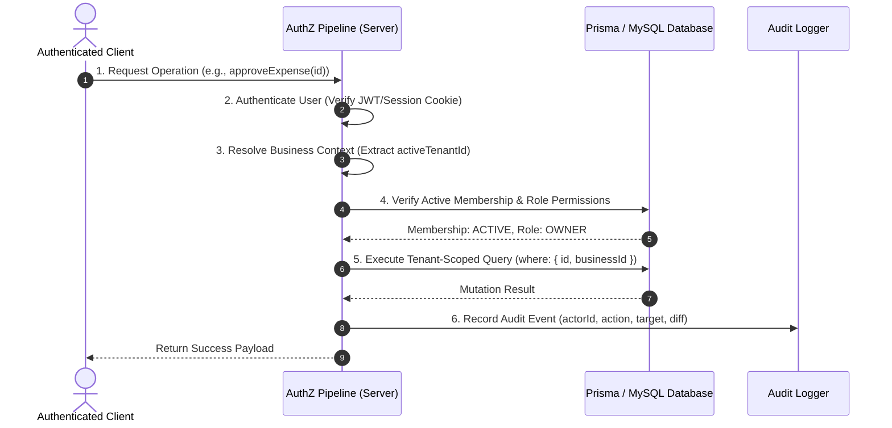

# Security Architecture & Authorization Engine — BusinessHub SaaS

This document establishes the application security model, authentication lifecycle, multi-tenant authorization guards, and defense-in-depth policies for **BusinessHub SaaS**.

---

## 1. The 6-Step Reusable Authorization Engine

Every protected mutation (Server Action) and data query follows an invariant, reusable 6-step execution pipeline:



### Pipeline Implementation Pattern:
```typescript
// lib/tenant/guards.ts (Architectural Pattern)
import "server-only";
import { getTenantContext, TenantContext } from "./context";
import { recordAuditEvent } from "@/modules/audit/services/audit.service";

export type RequiredPermission = 
  | "finance:approve" 
  | "finance:create" 
  | "mushroom:harvest:log" 
  | "tenancy:invite";

export async function withTenantGuard<TInput, TOutput>(
  requiredPermission: RequiredPermission,
  actionFn: (context: TenantContext, input: TInput) => Promise<TOutput>
) {
  return async (input: TInput): Promise<TOutput> => {
    // 1. Authenticate user & 2. Resolve business context
    const context = await getTenantContext();

    // 3. Verify active membership (handled inside getTenantContext)

    // 4. Verify required permission against role matrix
    const hasPermission = evaluateRolePermission(context.role, requiredPermission);
    if (!hasPermission) {
      throw new Error("FORBIDDEN_INSUFFICIENT_PERMISSIONS");
    }

    // 5. Execute tenant-scoped operation
    const result = await actionFn(context, input);

    // 6. Record audit event
    await recordAuditEvent({
      businessId: context.businessId,
      userId: context.userId,
      actionType: requiredPermission,
      metadata: { inputSummary: sanitizeInput(input) },
    });

    return result;
  };
}
```

---

## 2. Cryptographic Security Standards

### 2.1 Password Hashing & Key Derivation
- Passwords must be hashed using **Argon2id** (preferred) or **bcrypt** with a minimum work factor of 12.
- Salt is generated cryptographically per password and stored within the resulting modular crypt format string.

### 2.2 Invitation & Password Reset Tokens
- Invitations generate a cryptographically secure 256-bit random entropy string via `crypto.randomBytes(32).toString('hex')`.
- The raw token is sent exclusively in the invitation email URL (`/invite/[rawToken]`).
- The database stores **only** the **SHA-256 hash** of the token (`tokenHash = sha256(rawToken)`).
- If the database is compromised, unexpired invitation tokens cannot be reverse-engineered or used by an attacker to hijack accounts.
- Atomic consumption:
  ```sql
  UPDATE InvitationToken 
  SET status = 'CONSUMED' 
  WHERE tokenHash = :hash AND status = 'PENDING' AND expiresAt > NOW();
  ```

---

## 3. Defense-in-Depth Security Policies

| Threat Vector | Mitigation Strategy | Architectural Enforcement |
| :--- | :--- | :--- |
| **Cross-Tenant Data Leak** | Server-derived `businessId` filtering | Every Prisma query explicitly injects `where: { businessId: context.businessId }`. Never trust client payload. |
| **SQL Injection (SQLi)** | Parameterized queries | Prisma ORM uses prepared statements unconditionally. Raw queries require tagged template literals (`$queryRaw\`SELECT ...\``). |
| **Cross-Site Scripting (XSS)** | React JSX escaping & sanitization | HTML string interpolation is avoided; user-supplied text renders as React children. File uploads validate MIME type. |
| **Cross-Site Request Forgery (CSRF)** | Origin header verification | Next.js Server Actions automatically verify Origin and Host headers matching the request. |
| **Brute Force / Credential Stuffing** | IP and account rate limiting | In-memory or Redis sliding window limiter restricting auth attempts to 5 per 15 minutes. |
| **Secret Exposure** | Build-time isolation | Secrets reside exclusively in `.env.local` without `NEXT_PUBLIC_` prefixes. Client bundles are scanned during build. |
| **PII & Credential Logging** | Log redaction filter | Logging interceptors strip `password`, `token`, `secret`, and `authorization` keys from all console/system logs. |

---

## 4. Verification & Pen-Testing Scenarios

To ensure tenant isolation is not merely a theoretical claim, the test suite must execute the following automated security scenarios:

1. **Cross-Tenant ID Probing (IDOR Test)**:
   - User authenticated in Business A sends a Server Action request targeting an Expense ID belonging to Business B.
   - *Expected Outcome*: Query returns `null` or throws HTTP 404/403. Zero modifications to Business B data.
2. **Revoked Member Session Invalidation**:
   - Owner revokes Member X's membership.
   - Member X attempts to submit an expense using their existing session cookie.
   - *Expected Outcome*: Next.js server context extractor rejects the request immediately with `UNAUTHORIZED_TENANT_ACCESS`.
3. **Owner Quota Concurrent Flood**:
   - Automated script submits 10 simultaneous invite requests when only 1 owner seat remains.
   - *Expected Outcome*: Exactly 1 invitation succeeds; 9 requests reject with HTTP 409 Conflict.
