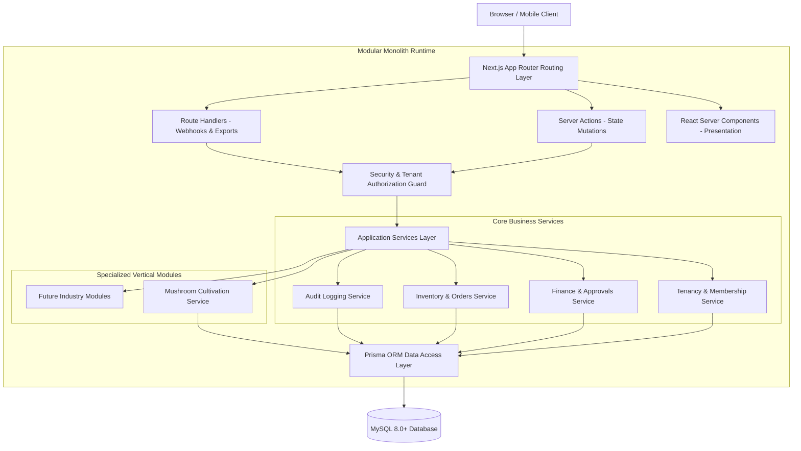
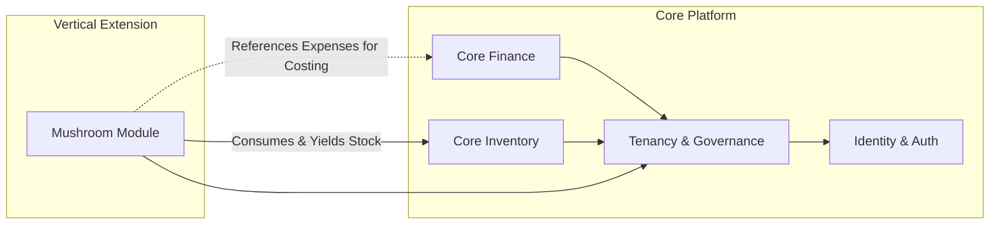

# System Architecture Specification — BusinessHub SaaS

## 1. Architectural Style & Philosophy: Modular Monolith

**BusinessHub SaaS** is engineered as a **Modular Monolith** using Next.js App Router (TypeScript), MySQL, and Prisma ORM. 

### 1.1 Rationale for Modular Monolith over Microservices
1. **Single Deployment & Hostinger Target**: Deployable as a single Node.js process managed by PM2 or Docker on a Hostinger VPS/Cloud server without complex service mesh or orchestrator overhead.
2. **ACID Transactional Integrity**: Cross-domain operations (e.g., deducting raw materials from Inventory, initializing a Mushroom Batch, and recording an Audit Event) execute within atomic MySQL database transactions (`prisma.$transaction`). Microservices would require distributed 2PC or Saga patterns with eventual consistency risks.
3. **Zero Network Serialization Overhead**: In-process function calls between modules eliminate inter-service HTTP/gRPC latency and partial network partition failure modes.
4. **Enforced Boundaries**: Codebase directories and TypeScript module interfaces enforce strict boundaries. If scaling demands extraction of a module later, boundaries are already cleanly decoupled.

---

## 2. Layered Architecture & Responsibilities

The application strictly separates five conceptual tiers:

| Layer | Technology / Artifacts | Responsibilities | Forbidden Patterns |
| :--- | :--- | :--- | :--- |
| **1. Presentation & UI** | React Server Components (RSC), Client Components (`"use client"`), Tailwind CSS, shadcn/ui | Rendering HTML, handling interactive form state, optimistic UI updates, client accessibility. | **NEVER** import Prisma client or access database directly. **NEVER** store business secrets or API keys. |
| **2. Application / Actions** | Next.js Server Actions, Route Handlers | Orchestrating user workflows, parsing input, calling validation schemas, managing session state. | **NEVER** trust client-supplied `businessId` or `role`. |
| **3. Security & Auth Guard** | `lib/auth/`, `lib/tenant/` | Authenticating session tokens, verifying tenant membership, checking role permissions, injecting validated `businessId`. | **NEVER** bypass tenant membership check on protected operations. |
| **4. Domain Services** | `modules/*/services/` | Pure business logic, accounting rules, biological efficiency calculations, owner quota checks, audit event creation. | Domain services must be framework-agnostic where possible. |
| **5. Data Access** | Prisma ORM, MySQL client | Schema definitions, migrations, relational queries, database transactions, connection pooling. | **NEVER** use unparameterized raw SQL strings. |

---

## 3. Server Components vs. Server Actions vs. Route Handlers

### 3.1 React Server Components (RSC) — Default for Presentation
- **Usage**: Dashboards, transaction tables, batch detail views, inventory catalogs, layout navigation.
- **Benefits**:
  - Zero JavaScript shipped to the client browser for data-fetching logic.
  - Direct secure server-side fetching without exposing internal REST endpoints.
  - Streaming with React Suspense for progressive page loading.

### 3.2 Next.js Server Actions — Default for Data Mutations
- **Usage**: Creating expenses, advancing batch phases, logging harvest yields, inviting members, approving drawings.
- **Rules**:
  - Must validate all input parameters against a strict **Zod** schema.
  - Must call the tenant authorization guard before executing any logic.
  - Must execute multi-record updates within `prisma.$transaction`.
  - Must trigger `revalidatePath` or `revalidateTag` to refresh cached RSC views.

### 3.3 Route Handlers (`app/api/*`) — Reserved for Specialized Operations
- **Usage**:
  - Streaming large CSV/PDF file exports (audit logs, tax reports).
  - Webhooks from external services (future payment notifications).
  - Health check endpoint (`/api/health`) for Hostinger uptime monitoring.
- **Rule**: Standard user UI forms must **NOT** create unnecessary REST Route Handlers when Server Actions provide direct type-safe RPC.

---

## 4. Modular Boundaries & Coupling Rules

### Invariant Rules:
1. **Core Platform is Domain-Agnostic**:
   - `core-finance` and `core-inventory` know **nothing** about mushroom strains, substrate recipes, or mycelium colonization.
   - Products are stored as general SKUs (e.g., "Oyster Mushroom Fresh 1kg", "Wheat Bran 25kg").
2. **Mushroom Extension Depends on Core Primitives**:
   - The mushroom module interacts with inventory by creating standard `StockMovement` records (`PRODUCTION_CONSUMPTION` for substrate ingredients; `PRODUCTION_YIELD` for harvested fresh/dried mushrooms).
   - The mushroom module references `InventoryItem` foreign keys without altering the core inventory schema.
3. **No Circular Dependencies**:
   - Dependency flow is strictly unidirectional: `vertical-module` -> `core-platform` -> `lib/primitives`.
