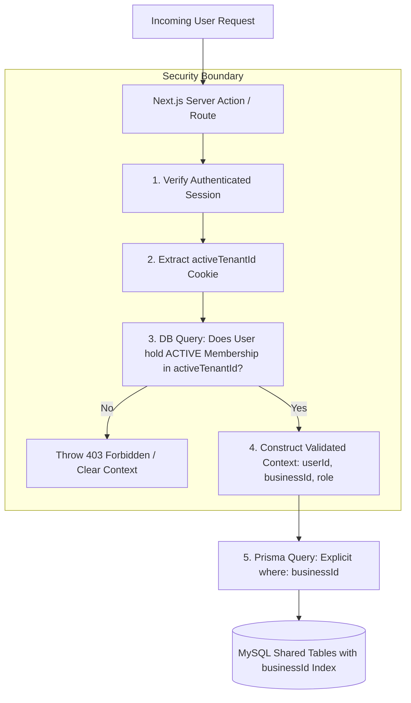
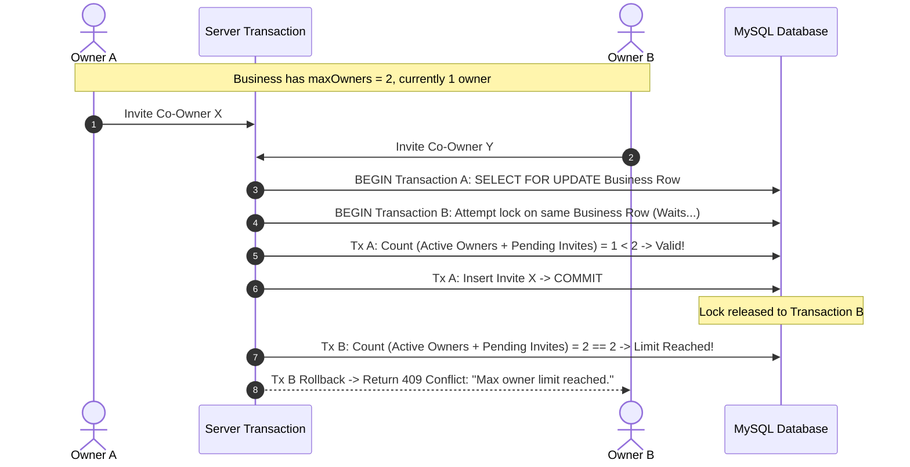

# Multi-Tenant Isolation & Owner Limit Enforcement — BusinessHub SaaS

This document details the multi-tenant security architecture, server-side context resolution, and concurrency-safe owner quota enforcement for **BusinessHub SaaS**.

---

## 1. Multi-Tenancy Architecture Model

BusinessHub SaaS utilizes a **Shared Database, Shared Schema with Discriminator Column (`businessId`)**.



### Key Security Invariants:
1. **Zero Client Trust**: A client request payload can **never** dictate the `businessId`. Any `businessId` field passed in a request body or URL parameter is discarded; the query context is derived exclusively from the authenticated session.
2. **Session Context Invalidation**: If an active member's role is revoked or their business membership is set to `REVOKED`, the server-side membership check rejects subsequent requests immediately without waiting for session token expiration.
3. **Compound Index Optimization**: Every tenant-scoped table maintains a compound index on `[businessId, createdAt]` or `[businessId, id]`, ensuring MySQL query execution plans filter by tenant key before scanning rows.

---

## 2. Server-Side Tenant Context Resolution Engine

All protected Server Actions and Server Component loaders pass through a central context resolution utility:

```typescript
// lib/tenant/context.ts (Architectural Specification)
import "server-only";
import { prisma } from "@/lib/db/prisma";
import { getSession } from "@/lib/auth/session";

export interface TenantContext {
  userId: string;
  businessId: string;
  role: "OWNER" | "PARTNER_FINANCE" | "PARTNER_OPS" | "STAFF" | "VIEWER";
  businessName: string;
}

export async function getTenantContext(): Promise<TenantContext> {
  const session = await getSession();
  if (!session || !session.userId) {
    throw new Error("UNAUTHENTICATED");
  }

  const activeBusinessId = session.activeBusinessId;
  if (!activeBusinessId) {
    throw new Error("NO_TENANT_SELECTED");
  }

  // Mandatory DB verification of active membership and tenant status
  const membership = await prisma.businessMembership.findUnique({
    where: {
      businessId_userId: {
        businessId: activeBusinessId,
        userId: session.userId,
      },
    },
    include: {
      business: { select: { id: true, name: true, status: true } },
    },
  });

  if (!membership || membership.status !== "ACTIVE") {
    throw new Error("UNAUTHORIZED_TENANT_ACCESS");
  }

  if (membership.business.status !== "ACTIVE") {
    throw new Error("BUSINESS_SUSPENDED");
  }

  return {
    userId: session.userId,
    businessId: activeBusinessId,
    role: membership.role as TenantContext["role"],
    businessName: membership.business.name,
  };
}
```

---

## 3. Concurrency-Safe Business Owner Limit Enforcement (1–10 Owners)

### 3.1 The Race Condition Problem
A business is configured with a limit between 1 and 10 owners (e.g., `maxOwners = 3`). Standard SQL `CHECK` constraints cannot evaluate aggregate functions like `COUNT(membership.id WHERE role = 'OWNER')` across multiple rows. 

If Owner A and Owner B simultaneously invite a new co-owner, naive validation (`if (count < 3) createInvite()`) creates a race condition where both transactions see count = 2 and proceed, resulting in 4 owners (violating the business invariant).



### 3.2 Transactional Locking Algorithm
To guarantee concurrency safety, owner invite and role-promotion mutations must execute within an explicit database transaction using **pessimistic row locking** on the parent `Business` record:

```typescript
// modules/core-tenancy/services/ownerQuota.service.ts (Architectural Pattern)
import "server-only";
import { prisma } from "@/lib/db/prisma";

export async function inviteCoOwnerSafe(
  businessId: string, 
  invitedEmail: string, 
  inviterUserId: string
) {
  return await prisma.$transaction(async (tx) => {
    // 1. Lock the parent Business row to serialize concurrent invitations
    const [lockedBusiness] = await tx.$queryRaw<[{ id: string; maxOwners: number }]>`
      SELECT id, maxOwners FROM Business WHERE id = ${businessId} FOR UPDATE
    `;

    if (!lockedBusiness) {
      throw new Error("BUSINESS_NOT_FOUND");
    }

    // 2. Count active owners
    const activeOwnersCount = await tx.businessMembership.count({
      where: {
        businessId,
        role: "OWNER",
        status: "ACTIVE",
      },
    });

    // 3. Count pending owner invitations
    const pendingOwnerInvitesCount = await tx.invitationToken.count({
      where: {
        businessId,
        role: "OWNER",
        status: "PENDING",
        expiresAt: { gt: new Date() },
      },
    });

    // 4. Strict ceiling validation
    if (activeOwnersCount + pendingOwnerInvitesCount >= lockedBusiness.maxOwners) {
      throw new Error("MAX_OWNERS_LIMIT_REACHED");
    }

    // 5. Generate secure token & persist invitation atomically
    const token = generateCryptographicToken();
    return await tx.invitationToken.create({
      data: {
        businessId,
        email: invitedEmail,
        role: "OWNER",
        tokenHash: hashToken(token),
        expiresAt: new Date(Date.now() + 48 * 3600 * 1000),
      },
    });
  });
}
```

---

## 4. Edge-Case Governance Scenarios

### 4.1 Last-Owner Removal Protection
- **Scenario**: An owner attempts to leave the business, revoke their own membership, or downgrade their role to `STAFF`.
- **Enforcement**:
  ```typescript
  if (targetRole !== "OWNER" || action === "REVOKE") {
    const totalOwners = await tx.businessMembership.count({
      where: { businessId, role: "OWNER", status: "ACTIVE" }
    });
    if (totalOwners <= 1) {
      throw new Error("CANNOT_REMOVE_SOLE_OWNER");
    }
  }
  ```
  A business must maintain at least 1 active owner at all times.

### 4.2 Ownership Transfer Workflow
- A primary owner can transfer primary ownership to an existing co-owner. Both parties retain owner permissions, but billing contact designation switches atomically.

### 4.3 Expired Invite Seat Deallocation
- Unclaimed owner invitations expire automatically after 48 hours.
- A background cron task or just-in-time query filters `expiresAt > now()` so expired invites never permanently lock owner seats.
