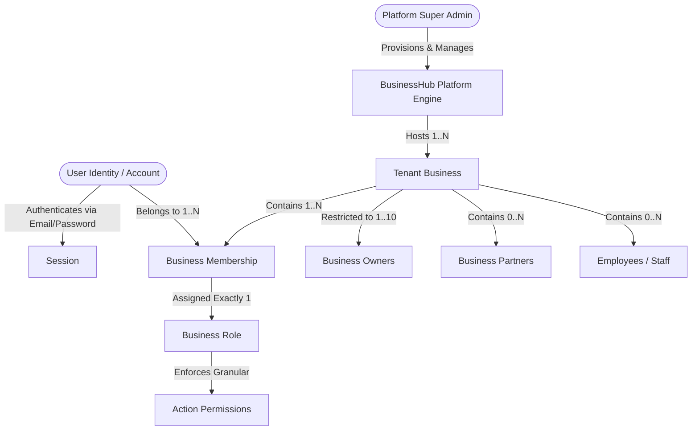
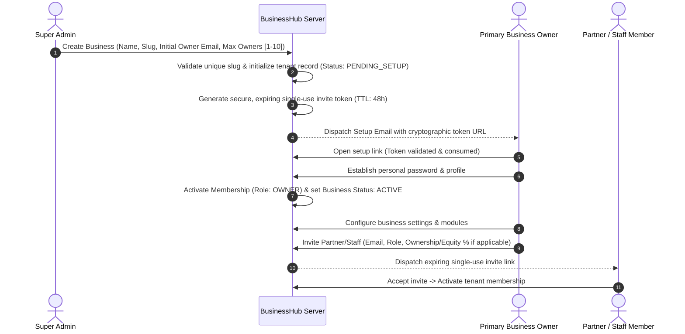
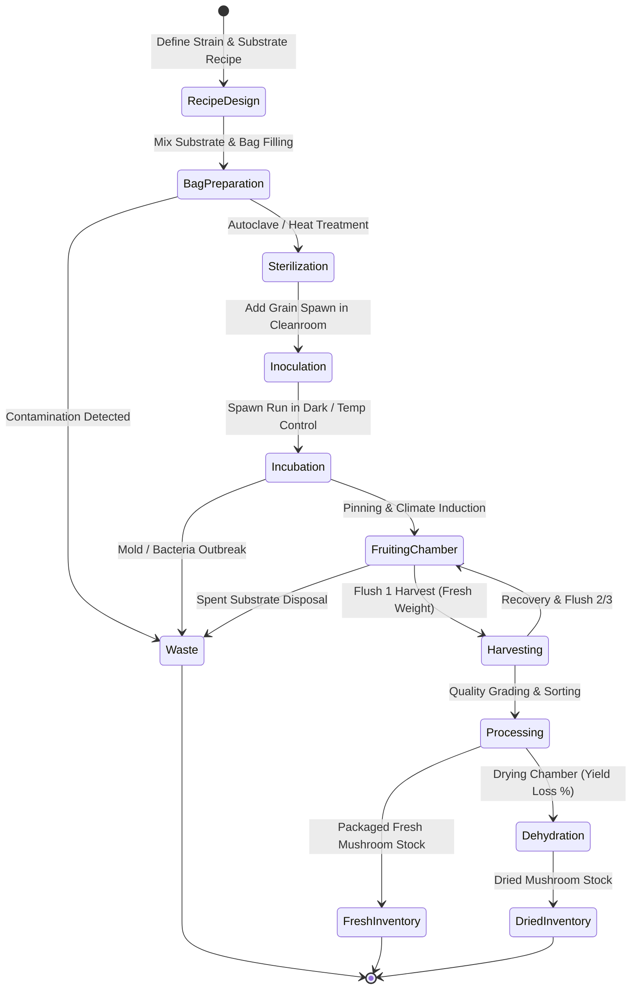

# Business Requirements Specification — BusinessHub SaaS

## 1. Executive Summary & Core Platform Vision

**BusinessHub SaaS** is a multi-tenant business management platform engineered for small-to-medium businesses (SMBs), partnerships, and specialized production enterprises. 

The application architecture establishes a modular foundation:
1. **Core Business Platform (Horizontal SaaS)**: Reusable primitives for identity, multi-tenancy, partner equity/loans, income/expense tracking, basic inventory, orders, customer/supplier directories, and role-based access control.
2. **Mushroom Production Module (Vertical Extension)**: A pluggable agricultural manufacturing extension supporting recipes, batch lifecycles, incubation, fruiting chambers, flush harvesting, waste tracking, and dried mushroom processing without polluting general business primitives.
3. **Future Extensibility**: Domain-agnostic core capable of supporting future vertical modules (e.g., hydroponics, craft brewing, light manufacturing) without re-architecting authentication, tenancy, or finance.

---

## 2. Tenancy, Identity & Relational Model

### 2.1 Identity Invariants
1. **Individual Identity**: Every user has one global account identified by a verified unique email address. Credentials belong to the human user, not the business tenant.
2. **Multi-Tenancy Membership**: A single `User` can be a member of multiple `Business` entities simultaneously (e.g., Owner of Farm A, Partner in Farm B, and Viewer in Retail C).
3. **Role Scoping**: Roles and permissions are strictly tenant-scoped through `Membership`. Being an Owner in Business A confers zero privileges in Business B.
4. **Owner Cardinality Constraint**: Every business must have at least 1 owner and at most 10 owners (`1 <= owners.count <= 10`). This boundary is strictly enforced server-side.
5. **Separation of Ownership vs Partnership**:
   - **Business Owner**: Holds legal administration authority (business settings, inviting co-owners/partners, managing billing, module activation, profit-distribution approvals).
   - **Business Partner**: Equity or capital contributor with financial visibility and withdrawal rights, but does NOT automatically hold full administrative ownership or platform settings control unless explicitly granted co-owner status.
   - **Employee / Staff**: Operational users with task-level and inventory access; barred from viewing partner capital, profit-sharing distributions, or company financial statements.
   - **Platform Super Admin**: Manages platform uptime, provisions new business tenants, and assigns initial owners. Super Admins do **not** have ambient access to tenant financial records.

---

## 3. Business Onboarding & Setup Lifecycle

### 3.1 Provisioning & Setup Stages

### 3.2 Invitation Security & Token Governance
- **Zero Plaintext Passwords**: The system shall **never** generate, store, log, or email passwords in plaintext.
- **Cryptographic Tokens**: Invitations generate a cryptographically random 256-bit token stored as a SHA-256 hash with an explicit expiration timestamp (`expiresAt = now() + 48 hours`).
- **Single-Use Enforcement**: Tokens are atomically marked `CONSUMED` upon successful password submission or membership confirmation.
- **Revocation & Expiry**:
  - If a token expires, the owner must trigger a "Resend Invite" action which invalidates the prior token and generates a new one.
  - Owners can explicitly "Revoke" pending invitations at any time.
- **Existing User Invitation**: If the invited email already has an active `User` account in BusinessHub, the setup link bypasses password creation and presents an "Accept Invitation to join [Business Name]" confirmation screen.
- **Duplicate Prevention**: Attempting to invite an email address that is already an active member of that tenant is rejected server-side with a validation error.

---

## 4. Core Business Management Requirements

### 4.1 Dashboard & Navigation
- Real-time tenant overview: Cash balance, revenue this month, pending expense approvals, low inventory alerts, active production batch summaries.
- Persistent **Tenant Selector** in header for multi-business users with active business indicator.

### 4.2 Partner & Ownership Management
- **Owner Roster**: Displays all active owners against the configurable business limit (e.g., "3 of 5 Owners assigned").
- **Capital Contribution Tracking**: Ledger of initial capital injected by each partner/owner, date of deposit, bank reference, and associated equity percentage.
- **Partner Loans & Repayments**: Formal tracking of loans provided by partners to the business (principal, agreed interest rate, repayment schedules, and disbursements).
- **Withdrawals & Drawings**: Partner draws logged against retained earnings or capital balance, requiring co-owner approval if above a configurable threshold.

### 4.3 Financial Operations (Income & Expenses)
- **Income Logging**: Customer payments, wholesale cash receipts, invoice settlements with category tagging.
- **Expense Logging**: Operational expenses, raw material purchases, utilities, labor payments.
- **Receipt Attachments**: Secure upload of invoice/receipt images or PDFs.
- **Two-Tier Expense Approval**: Configurable workflow where expenses exceeding a set threshold (e.g., > $500) require approval by a Business Owner before ledger commitment.
- **Audit Immutability**: Closed financial periods lock transactions from deletion or silent modification. Adjustments require reversing journal entries.

### 4.4 Products & Inventory
- Generic product catalog: SKU, item name, category, unit of measure (kg, gram, piece, bag, liter), reorder threshold.
- Stock movements: Inward purchase, outward sale, scrap/adjustment, production consumption.

### 4.5 Sales & Customer Management
- Customer directory (wholesale distributors, retail buyers, restaurants).
- Order creation: Line items, tax, discounts, delivery dates, fulfillment status (`DRAFT`, `CONFIRMED`, `DISPATCHED`, `DELIVERED`, `CANCELLED`).
- Invoicing and payment status tracking (`UNPAID`, `PARTIAL`, `PAID`).

---

## 5. Finance & Profit-Sharing Rules

### 5.1 Business Principles & Invariants
1. **Separation of Equity vs. Profit Allocation**:
   - *Equity Percentage*: Represents asset ownership upon company liquidation.
   - *Profit-Sharing Ratio*: Configurable distribution agreement for operating net profits, which may be equal or weighted differently from equity.
2. **Accounting Period Closing**:
   - Profit distributions are calculated exclusively over closed financial periods (e.g., Monthly, Quarterly, Annual).
   - Once an accounting period is closed, historical numbers are locked. Rule changes apply only to subsequent periods.
3. **Reserve Deductions**:
   - Before distributing net profits, businesses can allocate a configurable percentage to **Retained Earnings / Emergency Reserves** (e.g., 20% retained, 80% distributed).
4. **Treatment of Partner Loans vs Capital**:
   - Partner loans are liabilities; interest payments are deductible expenses.
   - Capital contributions are equity; capital cannot be withdrawn as an expense.

---

## 6. Mushroom Production Extension Module

The mushroom cultivation module tracks biological manufacturing lifecycles through discrete stages:

### 6.1 Substrate Recipes & Material Allocation
- **Recipe Master**: Bill of Materials (BOM) specifying raw material ratios per batch (e.g., Sawdust 60%, Wheat Bran 25%, Gypsum 5%, Lime 2%, Water 8%).
- **Raw Material Consumption**: Automatically deducts raw ingredients from Core Inventory upon batch initialization.

### 6.2 Batch & Bag Lifecycle Management
- **Batch Identifier**: Unique barcode/batch code format: `MB-[STRAIN]-[YYYYMMDD]-[SEQ]` (e.g., `MB-OYS-20261017-01`).
- **Bag Quantity Tracking**: Total bags prepared, sterilized, and inoculated.
- **Phase Monitoring**:
  - *Incubation*: Days in dark room, temperature, humidity, mycelium colonization percentage.
  - *Fruiting*: Chamber assignment, CO2 levels, relative humidity (RH), lighting cycle.
- **Contamination & Waste Logging**: Contaminated bags discarded per phase with reason codes (Trichoderma, Cobweb mold, bacterial blotch, dry bubble).

### 6.3 Harvests, Grading & Processing
- **Flush Tracking**: Supports multiple harvest flushes (Flush 1, Flush 2, Flush 3).
- **Yield Logging**: Harvest date, picker, raw wet weight (kg), quality grade (Grade A / Premium, Grade B / Standard, Processing Grade).
- **Secondary Processing (Dehydration)**:
  - Input fresh weight vs. output dried weight ratio calculation (typically ~90% water loss).
  - Production of secondary SKU: Dried Oyster Mushroom (e.g., 100g packaged pouch).
- **Inventory Transfer**: Automatically transfers harvested yields into salable Core Product Inventory.

---

## 7. Future SaaS Capabilities (Post-MVP Boundaries)

The following capabilities are architecturally anticipated but strictly excluded from the initial MVP release:
1. **Tiered SaaS Billing & Stripe Integration**: Automated credit card billing, free trials, and seat-based upgrades.
2. **Automated Platform SMS / WhatsApp Notifications**: Automated harvest alerts via Twilio.
3. **Advanced IoT Sensor Integration**: MQTT telemetry ingestion from environmental sensor probes in fruiting rooms.
4. **Additional Vertical Extensions**: Specialized modules for Microgreens, Beekeeping, or Aquaponics.
