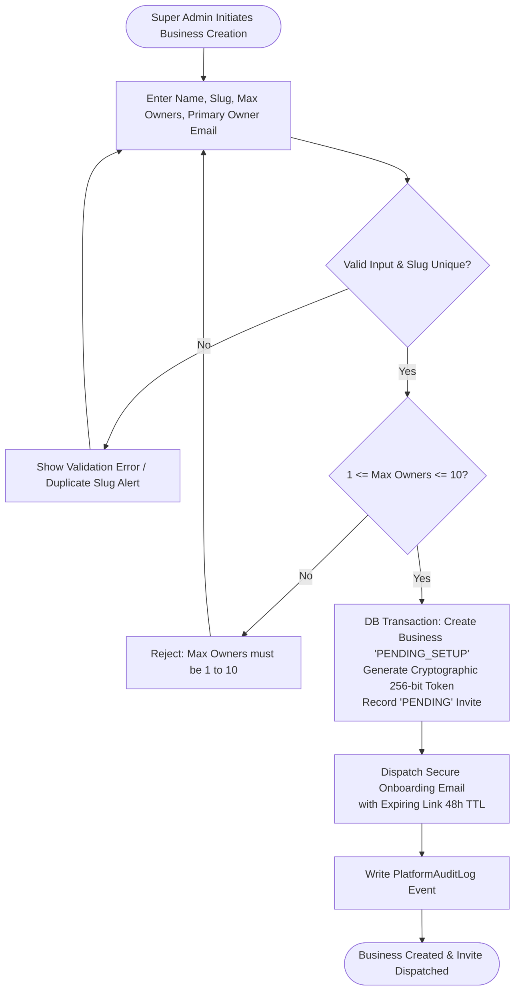
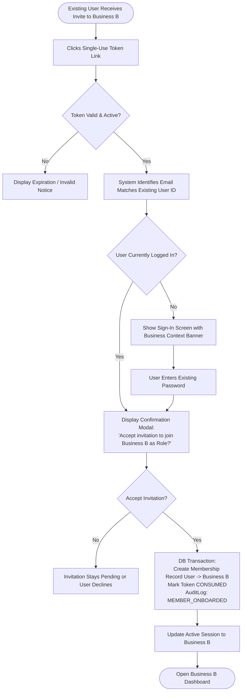
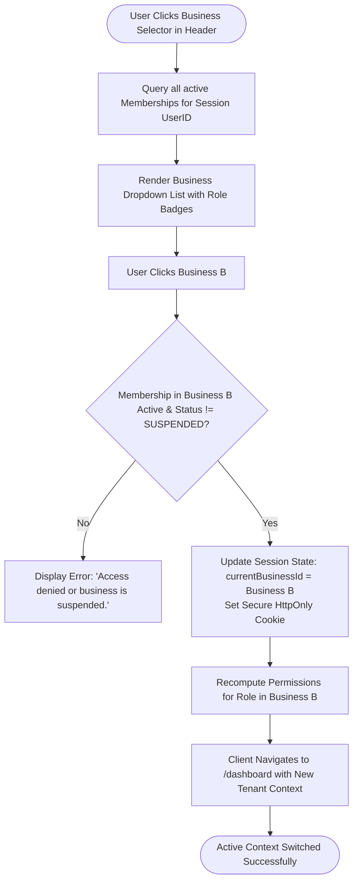
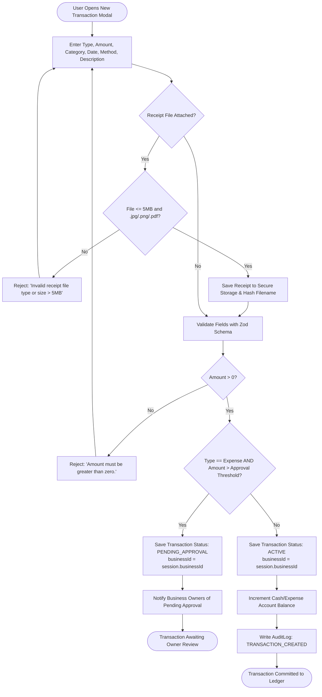
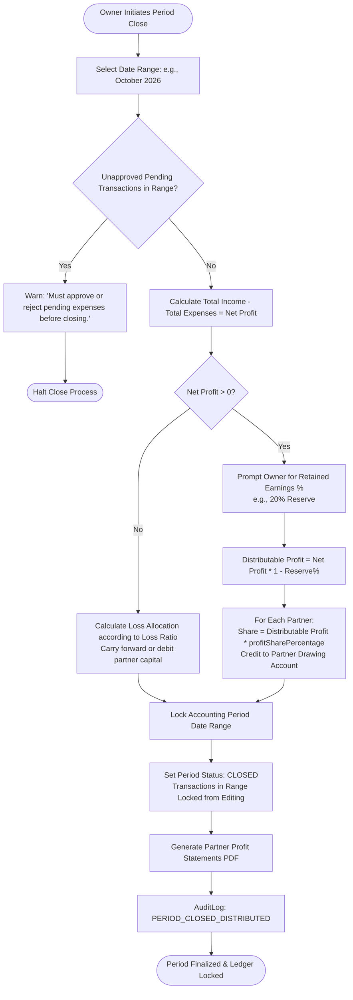
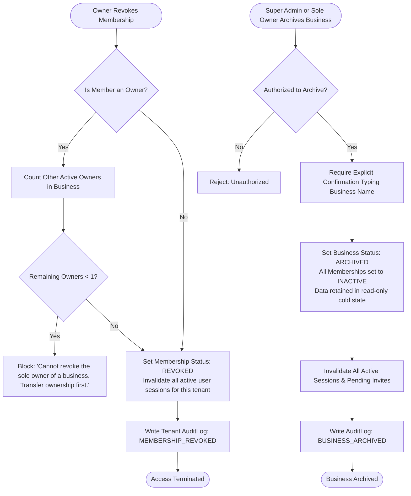

# Business Workflows Specification — BusinessHub SaaS

This document establishes the end-to-end operational workflows for **BusinessHub SaaS** using Mermaid diagrams, detailing decision logic, validation gates, authorization checks, and failure paths.

---

## 1. Super Admin Creates Business & Assigns Owners



---

## 2. Owner Accepts Invitation & Sets Up Account

```mermaid
flowchart TD
    Start([User Clicks Invitation Link in Email]) --> ParseToken[Extract Token Hash from URL]
    ParseToken --> CheckToken{Token in DB & Status == PENDING?}
    
    CheckToken -- No --> CheckConsumed{Status == CONSUMED?}
    CheckConsumed -- Yes --> ErrConsumed[Error: 'This invitation has already been used.']
    CheckConsumed -- No --> ErrInvalid[Error: 'Invalid or expired invitation link.']
    
    CheckToken -- Yes --> CheckExpiry{expiresAt > now()?}
    CheckExpiry -- No --> ErrExpired[Error: 'Invitation has expired. Request a new link.']
    
    CheckExpiry -- Yes --> CheckExistingUser{Email already has a User account?}
    
    CheckExistingUser -- Yes --> LoginPrompt[Prompt User to Authenticate with Existing Password]
    LoginPrompt --> AuthSuccess{Credentials Valid?}
    AuthSuccess -- No --> LoginPrompt
    AuthSuccess -- Yes --> LinkMembership[Create Business Membership Role: OWNER<br/>Mark Token CONSUMED<br/>Set Business Status: ACTIVE]
    LinkMembership --> DoneDashboard([Redirect to Business Dashboard])
    
    CheckExistingUser -- No --> DisplaySetupForm[Display Account Setup Form:<br/>Full Name, Password, Confirm Password]
    DisplaySetupForm --> ValidatePwd{Password Policy Met?<br/>>=10 chars, upper, lower, number, symbol}
    ValidatePwd -- No --> FormErr[Display Password Requirements Error]
    FormErr --> DisplaySetupForm
    
    ValidatePwd -- Yes --> CreateUserRecord[DB Transaction:<br/>Hash Password Argon2id<br/>Create User Record<br/>Create Membership Role: OWNER<br/>Mark Token CONSUMED<br/>Set Business Status: ACTIVE]
    CreateUserRecord --> AutoLogin[Establish Authenticated Session Cookie]
    AutoLogin --> DoneDashboard
```

---

## 3. Owner Invites Partner or Staff Member

```mermaid
flowchart TD
    Start([Owner Initiates Invite Modal]) --> FormInput[Input Email, Select Role: Co-Owner / Partner / Staff]
    FormInput --> CheckRole{Selected Role == Co-Owner?}
    
    CheckRole -- Yes --> QueryOwnerCount[Count Active Owners + Pending Owner Invites]
    QueryOwnerCount --> CheckLimit{Count < maxOwners?}
    CheckLimit -- No --> RejectLimit[Reject: 'Maximum owner limit reached. Cannot invite more co-owners.']
    
    CheckRole -- No --> CheckMemberExists[Query if Email is already active in this Business]
    CheckLimit -- Yes --> CheckMemberExists
    
    CheckMemberExists --> MemberFound{Already a Member?}
    MemberFound -- Yes --> RejectMember[Reject: 'User is already an active member of this business.']
    
    MemberFound -- No --> GenToken[Generate Cryptographic Single-Use Token<br/>expiresAt = now() + 48h<br/>Store SHA-256 Hash]
    GenToken --> SendInviteMail[Send Email: 'You have been invited to join BusinessName']
    SendInviteMail --> LogEvent[Write Tenant AuditLog Event: MEMBER_INVITED]
    LogEvent --> Success([Invite Pending in Member Table])
```

---

## 4. Existing User Joins Another Business



---

## 5. User Switches Between Authorized Businesses



---

## 6. User Records Income or Expense



---

## 7. Owner Approves or Rejects a Transaction

```mermaid
flowchart TD
    Start([Owner Opens Pending Approval Queue]) --> ViewTx[Inspect Transaction Details, Category & Receipt Image]
    ViewTx --> CheckSelfApproval{Is Owner also the Submitter?}
    
    CheckSelfApproval -- Yes --> SoleOwnerCheck{Is Submitter the Sole Owner?}
    SoleOwnerCheck -- No --> BlockSelfApprove[Block: 'Approval requires a different business owner.']
    SoleOwnerCheck -- Yes --> Decision{Owner Decision}
    
    CheckSelfApproval -- No --> Decision{Owner Decision}
    
    Decision -- Approve --> DBApprove[DB Transaction:<br/>Set Status = ACTIVE<br/>Set approvedBy = OwnerID<br/>Set approvedAt = now()]
    DBApprove --> UpdateFinancials[Update Financial Statements & Net Profit Totals]
    UpdateFinancials --> LogApprove[AuditLog: TRANSACTION_APPROVED]
    LogApprove --> DoneApprove([Transaction Approved & Active])
    
    Decision -- Reject --> EnterComment[Require Mandatory Rejection Reason]
    EnterComment --> DBReject[DB Transaction:<br/>Set Status = REJECTED<br/>Set rejectionReason = Comment]
    DBReject --> LogReject[AuditLog: TRANSACTION_REJECTED]
    LogReject --> DoneReject([Transaction Rejected & Archived])
```

---

## 8. Business Calculates Profit Distribution for a Closed Period



---

## 9. Mushroom Production: Batch Creation through Harvest & Sales

```mermaid
flowchart TD
    Start([Technician Launches New Batch]) --> SelectRecipe[Select Strain, Recipe BOM & Target Bag Count]
    SelectRecipe --> DeductRawMaterials[Check Stock & Deduct Raw Substrate/Spawn from Core Inventory]
    DeductRawMaterials --> GenBatchCode[Generate Batch ID: MB-STRAIN-YYYYMMDD-SEQ]
    GenBatchCode --> PhasePrep[Phase: PREPARATION -> Mixing & Bag Filling]
    
    PhasePrep --> PhaseSterile[Phase: STERILIZATION -> Autoclaving / Steaming]
    PhaseSterile --> PhaseInoc[Phase: INOCULATION -> Cleanroom Grain Spawn Addition]
    PhaseInoc --> PhaseIncubate[Phase: INCUBATION -> Dark Room Colonization Monitoring]
    
    PhaseIncubate --> CheckContam1{Contamination Detected?}
    CheckContam1 -- Yes --> LogDiscard1[Log Discarded Bags & Reason Code<br/>Decrement Viable Count]
    LogDiscard1 --> CheckViable{Viable Bags Remaining?}
    CheckViable -- No --> TerminateBatch([Batch Terminated as Contaminated])
    CheckViable -- Yes --> ColonizedCheck{100% Colonized?}
    CheckContam1 -- No --> ColonizedCheck
    
    ColonizedCheck -- No --> PhaseIncubate
    ColonizedCheck -- Yes --> MoveFruiting[Phase: FRUITING -> Transfer to Chamber Room ID]
    
    MoveFruiting --> DailyCare[Daily Care: Watering, Airflow, Temperature & RH Logs]
    DailyCare --> ReadyHarvest{Pinheads Mature to Flush Harvest?}
    ReadyHarvest -- No --> DailyCare
    
    ReadyHarvest -- Yes --> LogHarvest[Log Harvest: Date, Flush #, Fresh Weight kg, Quality Grade]
    LogHarvest --> AutoStockFresh[Auto-Increment Core Inventory: Fresh Mushroom Stock]
    AutoStockFresh --> RouteHarvest{Stock Destination?}
    
    RouteHarvest -- Fresh Wholesale / Retail --> CreateSalesOrder[Fulfill Customer Order -> Invoice & Payment]
    CreateSalesOrder --> FinishCycle([Fresh Sales Completed])
    
    RouteHarvest -- Dehydration Processing --> DryingChamber[Transfer Fresh Stock to Drying Chamber]
    DryingChamber --> OutDried[Record Final Dried Weight kg<br/>Compute Yield Ratio & Increment Dried SKU Stock]
    OutDried --> DriedSales[Package & Sell Dried Mushrooms]
    DriedSales --> FinishCycle
    
    LogHarvest --> NextFlush{Batch Capable of Another Flush?}
    NextFlush -- Yes --> MoveFruiting
    NextFlush -- No --> SpendSubstrate[Mark Batch COMPLETED -> Dispose Spent Compost]
    SpendSubstrate --> FinishCycle
```



---

## 10. Business Archival or Membership Revocation


