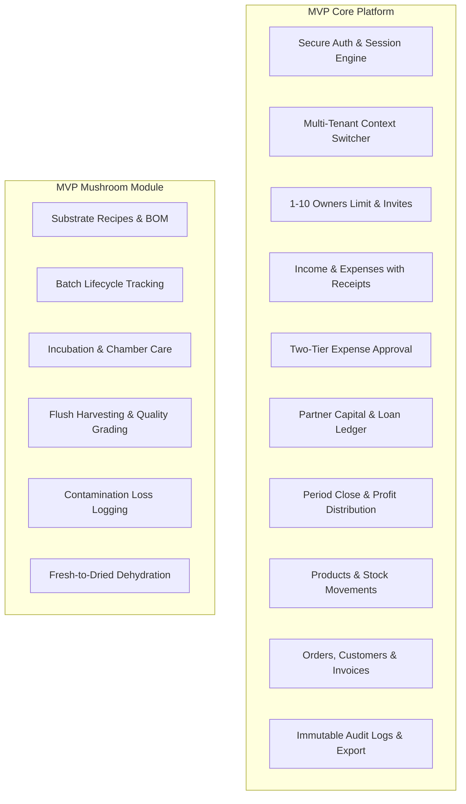

# MVP Scope & Phased Feature Boundaries — BusinessHub SaaS

This document establishes the definitive boundaries between the Minimum Viable Product (MVP) release and future planned capabilities for **BusinessHub SaaS**.

---

## 1. Scope Boundary Philosophy

To achieve rapid time-to-value while ensuring a robust, enterprise-grade architecture:
1. **MVP Scope** includes everything required to provision a multi-tenant business, manage equity and finances, run daily operations, and track complete mushroom cultivation lifecycles from spore to sale.
2. **Post-MVP Scope** defers automated payment gateway billing, IoT telemetry ingestion, and external SMS gateways until the core application is field-tested and validated.

---

## 2. In-Scope: MVP Baseline Deliverables

### 2.1 Identity, Tenancy & Governance (MVP)
- [x] Global user identity with single email login.
- [x] Multi-tenant membership: 1 user can belong to multiple businesses.
- [x] Tenant context selector in header with persistent active state.
- [x] Super Admin business provisioning and initial owner assignment.
- [x] Business owner quota enforcement (configurable 1–10 owners, validated server-side).
- [x] Expiring, single-use cryptographic invitation links (48-hour TTL).
- [x] Zero plaintext passwords stored, transmitted, or logged.

### 2.2 Core Business Management (MVP)
- [x] Financial income and expense logging with receipt file attachments (JPG, PNG, PDF).
- [x] Two-tier expense approval for transactions exceeding the business threshold.
- [x] Partner equity, capital contributions, loans, interest, and drawing requests.
- [x] Accounting period closing with configurable reserve deductions and profit distribution calculations.
- [x] Core product catalog with unit costs, selling prices, and stock movements.
- [x] Customer orders, invoice status tracking, and supplier contact directory.
- [x] Immutable tenant audit log with CSV export capability.

### 2.3 Mushroom Cultivation Specialized Module (MVP)
- [x] Substrate Bill of Materials (BOM) recipes with automatic inventory deduction.
- [x] Batch code generation (`MB-[STRAIN]-[YYYYMMDD]-[SEQ]`) and bag count tracking.
- [x] Lifecycle phase progression: Preparation -> Sterilization -> Inoculation -> Incubation -> Fruiting -> Completed.
- [x] Daily room temperature, humidity, and environmental care logs.
- [x] Flush harvest logging with quality grade breakdown (Grade A, Grade B, Scrap).
- [x] Automatic inventory influx of harvested fresh mushrooms.
- [x] Contamination outbreak logging with specific reason codes.
- [x] Fresh-to-dried mushroom dehydration runs with moisture loss calculations.

---

## 3. Out-of-Scope: Deferred to Future Phases (Post-MVP)

| Feature / Capability | Planned Future Phase | Rationale for Post-MVP Deferral |
| :--- | :--- | :--- |
| **Automated SaaS Subscription Billing (Stripe / Paddle)** | Phase 2 (Commercialization) | Initial commercial rollout will use manual invoicing by Super Admin while verifying customer retention. |
| **Automated SMS & WhatsApp Alerts (Twilio)** | Phase 2 (Notifications) | Email notifications and in-app banners satisfy MVP communication requirements without third-party telecommunication costs. |
| **IoT Environmental Sensor Ingestion (MQTT / WebSockets)** | Phase 3 (Hardware Integration) | Manual technician logging is sufficient for small-scale operations; avoids premature hardware protocol lock-in. |
| **Barcode / QR Code Camera Scanning** | Phase 2 (Mobile Optimization) | Mobile web dropdowns and search inputs are sufficient for MVP batch lookups. |
| **AI Yield Prediction & Disease Diagnostics** | Phase 4 (AI Extensions) | Requires a large historical dataset of completed flushes and contamination photos before ML models can be reliable. |
| **Additional Vertical Modules (Microgreens, Aquaponics)** | Phase 3 (Vertical Expansion) | Focus exclusively on perfecting the mushroom cultivation module before abstracting generic agricultural schemas. |

---

## 4. Delivery Milestones & Phasing

- **Phase 1 (Current — Tasks 0 to 4)**: Technical foundation, requirements, system architecture, database schema, and authentication engine.
- **Phase 2 (Tasks 5 to 7)**: Core business features, multi-owner governance, and complete mushroom production module.
- **Phase 3 (Task 8)**: Automated end-to-end integration tests, multi-tenant isolation verification, and security audit.
- **Phase 4 (Task 9)**: Hostinger staging deployment, PM2/Docker scripts, backup automation, and production handover.
