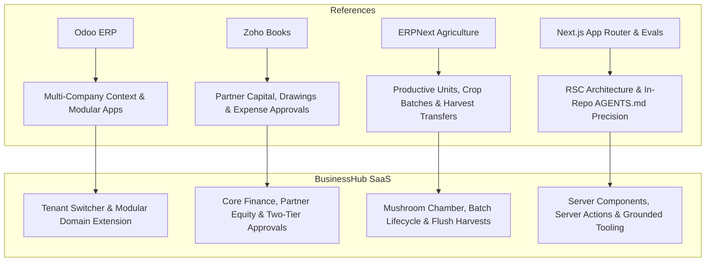

# Reference Product Analysis & Architectural Benchmarks

This document captures architectural and product findings from public reference systems, detailing design concepts adopted for **BusinessHub SaaS** and identifying patterns explicitly rejected.

---

## 1. Product Benchmark & Reference Summary

---

## 2. In-Depth Reference Evaluations

### 2.1 Odoo ERP (`odoo.com`)
- **Product Overview**: Modular open-core ERP platform with multi-company support across sales, accounting, inventory, and manufacturing.
- **Valuable Concepts Adopted**:
  1. *Persistent Multi-Company Header Switcher*: Allows users with multi-entity memberships to toggle tenant context instantaneously.
  2. *Modular Decoupling*: Core apps (Inventory, Accounting, Sales) exist independently of specialized manufacturing or operational modules.
  3. *Audit Trail on Documents*: Detailed historical tracking of who created, edited, and approved each document.
- **Patterns Rejected / Outside Scope**:
  - *Monolithic Database Entanglement*: Odoo's framework tightly couples models in a monolithic Python ORM; BusinessHub keeps modular domain extensions decoupled via clean foreign keys.
  - *Excessive Double-Entry Complexity*: Odoo's general ledger configuration is too overwhelming for non-accountant farm operators. We provide simplified, audit-ready income/expense/equity tracking.

---

### 2.2 Zoho Books (`zoho.com/books/`)
- **Product Overview**: Cloud-based accounting software tailored for small businesses and partnerships.
- **Valuable Concepts Adopted**:
  1. *Partner Capital & Drawings Accounts*: Dedicated accounting tracking for partner equity, loans, and withdrawal requests.
  2. *Two-Tier Expense Approval*: Transactions over a set threshold require owner sign-off before entering general ledgers.
  3. *Audit-Ready Receipts*: Direct image/PDF attachment binding to individual expense transactions.
- **Patterns Rejected / Outside Scope**:
  - *Rigid Desktop-Centric UI*: Over-cluttered desktop grids that degrade on mobile devices.
  - *Zero Agricultural or Manufacturing Lineage*: Incapable of tracking biological batches, yields, or flush cycles without expensive bespoke customizations.

---

### 2.3 ERPNext Agriculture Module (`docs.frappe.io/erpnext`)
- **Product Overview**: Open-source ERP agricultural module tracking plots, crops, diseases, and harvests.
- **Valuable Concepts Adopted**:
  1. *Productive Units*: Modeling production areas (chambers/rooms) where batches mature.
  2. *Time-Sensitive Operational Care Logs*: Logging daily environmental readings, watering, and inspection tasks.
  3. *Harvest-to-Warehouse Stock Influx*: Direct automatic transfer of harvested crop weights into warehouse inventory for sale or secondary processing.
- **Patterns Rejected / Outside Scope**:
  - *Outdoor / Open-Field GIS Features*: Soil texture, GPS polygons, and irrigation canal features are irrelevant for controlled-environment mushroom cultivation.
  - *Generic "Crop" Abstraction*: Outdoor crops have single harvest cycles, whereas mushrooms have multiple flushes, bag contamination risks, and dehydration processing requiring a dedicated domain model.

---

### 2.4 Next.js Official Evals & App Router Documentation (`nextjs.org/evals`)
- **Engineering Overview**: Vercel benchmarks demonstrating agent coding performance and modern full-stack App Router best practices.
- **Valuable Concepts Adopted**:
  1. *In-Repo `AGENTS.md` Outperforms External Skills*: Grounded, version-accurate rules within the repository outperform third-party dynamic skill injections in agent coding accuracy.
  2. *Server-First React Architecture (RSC)*: Keeps database queries and secrets on the server; client components are reserved exclusively for interactive forms and modals.
  3. *Server Actions with Zod Validation*: Safe, type-validated data mutations without boilerplate REST controller layers.
- **Patterns Rejected / Outside Scope**:
  - *Heavy Client-Side State Stores*: Avoid global Redux/Zustand boilerplate where Next.js Server Components and URL query parameter state provide cleaner, cache-invalidating alternatives.

---

## 3. Product Comparison Matrix

| Reference Product | Evaluated Capability | BusinessHub-SaaS Equivalent Feature | MVP Priority | Adaptation / Innovation in BusinessHub |
| :--- | :--- | :--- | :--- | :--- |
| **Odoo ERP** | Multi-Company Context Switcher | Top-Bar Business Selector Component | **P0** | Tenant-scoped session cookie updating server context seamlessly without logging out. |
| **Odoo ERP** | Modular App Grid | Modular Extensible Directory Architecture | **P0** | Clean relational separation between core inventory and specialized mushroom batches. |
| **Zoho Books** | Partner Capital & Drawings | `/finance/partners` Equity & Loan Ledger | **P1** | Explicit separation of ownership equity vs. partner loans with repayment tracking. |
| **Zoho Books** | Expense Approval Thresholds | Two-Tier Expense Approval Workflow | **P1** | Automated routing of expenses `> threshold` to Business Owner queue with receipt preview. |
| **ERPNext** | Crop Cycle & Land Unit Tracking | Mushroom Batch Lifecycle & Chamber Tracking | **P0** | Tailored to mushroom bags, sterilization, incubation, and fruiting room conditions. |
| **ERPNext** | Harvest Recording to Stock | Flush Yield Logging with Auto-Inventory Influx | **P0** | Records Flush # (1, 2, 3), quality grades (A, B, Scrap), and auto-increments fresh inventory. |
| **ERPNext** | Post-Harvest Processing | Fresh-to-Dried Dehydration Run | **P1** | Computes moisture loss % and automatically transfers fresh stock into dried mushroom stock. |
| **Next.js** | App Router Server Actions | Type-Safe Zod Server Actions | **P0** | Every mutation enforces tenant `businessId` checks and input schema validation. |
| **Next.js** | Agent Evals & In-Repo Docs | Root `AGENTS.md` Development Rules | **P0** | Concise, deterministic rules preventing model hallucination and obsolete API usage. |
