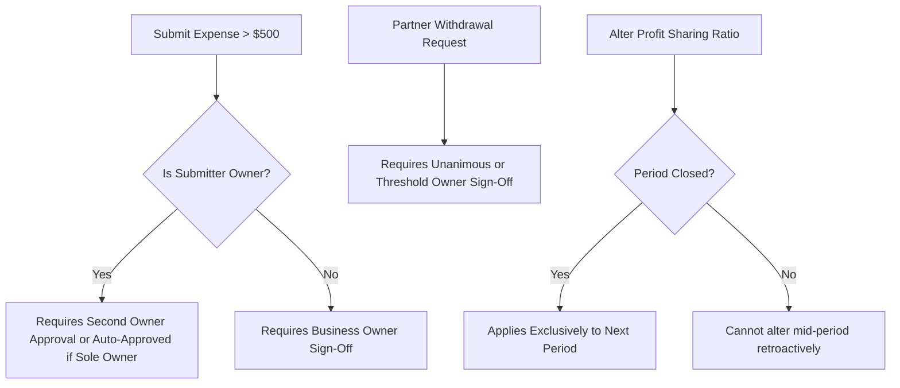

# Role & Permission Matrix Specification — BusinessHub SaaS

## 1. Permission Model Principles

Access control in **BusinessHub SaaS** enforces strict multi-tenant boundaries and principle-of-least-privilege:
1. **Tenant Scoping**: All tenant-level permissions are evaluated exclusively against the active `businessId` derived from the server session.
2. **Platform vs. Tenant Separation**: Platform administration rights do not confer ambient read/write privileges over private business records.
3. **Dual Approval Controls**: High-risk financial operations (e.g., expenses > threshold, partner drawings, profit-sharing ratio adjustments) require multi-owner or explicit role elevation.

---

## 2. Granular Role & Permission Matrix

| Capability / Action Area | Platform Super Admin | Business Owner | Business Partner (Finance) | Business Partner (Operations) | Employee / Staff | Read-Only Auditor | Extra Approval / Invariant |
| :--- | :--- | :--- | :--- | :--- | :--- | :--- | :--- |
| **Tenant Provisioning** | **Full Access** | No Access | No Access | No Access | No Access | No Access | Platform-only action |
| **Assign Initial Owners** | **Full Access** | No Access | No Access | No Access | No Access | No Access | Must enforce 1–10 limit |
| **Invite Co-Owners** | No Access | **Own-Business Access** | No Access | No Access | No Access | No Access | Blocked if owners count reaches limit |
| **Invite Partners & Staff** | No Access | **Own-Business Access** | Explicitly Granted | Explicitly Granted | No Access | No Access | Single-use expiring token |
| **Manage Memberships & Roles**| No Access | **Own-Business Access** | No Access | No Access | No Access | No Access | Cannot revoke own last owner seat |
| **Update Business Profile & Settings** | System Only | **Own-Business Access** | No Access | No Access | No Access | No Access | Legal and tax configurations |
| **View Income & Expense Ledgers** | No Access | **Own-Business Access** | **Own-Business Access** | Limited (Ops Only) | No Access | **Read-Only** | Employee strictly barred |
| **Record Income / Sales Receipts**| No Access | **Own-Business Access** | **Own-Business Access** | **Own-Business Access** | No Access | No Access | Immutable transaction log |
| **Submit Expense Entries** | No Access | **Own-Business Access** | **Own-Business Access** | **Own-Business Access** | Explicitly Granted | No Access | Receipt upload required |
| **Approve Expenses (> Threshold)**| No Access | **Own-Business Access** | Explicitly Granted | No Access | No Access | No Access | Submitter cannot self-approve |
| **Manage Capital Contributions** | No Access | **Own-Business Access** | View Only | No Access | No Access | **Read-Only** | Requires owner sign-off |
| **Track Partner Loans & Repayments** | No Access | **Own-Business Access** | View Only | No Access | No Access | **Read-Only** | Formal repayment schedule |
| **Request Partner Withdrawals** | No Access | **Own-Business Access** | **Own-Business Access** | No Access | No Access | No Access | Must be approved by co-owner |
| **Configure Profit-Sharing Rules** | No Access | **Own-Business Access** | View Only | No Access | No Access | **Read-Only** | Requires all-owner consensus |
| **Close Accounting Period & Distribute**| No Access | **Own-Business Access** | View Only | No Access | No Access | No Access | Locks historical records |
| **Manage Product Catalog & Pricing**| No Access | **Own-Business Access** | View Only | **Own-Business Access** | No Access | **Read-Only** | Cost and selling price fields |
| **Manage Inventory & Stock Adjustments** | No Access | **Own-Business Access** | View Only | **Own-Business Access** | Explicitly Granted | **Read-Only** | Reason code required for scrap |
| **Manage Customers & Suppliers**| No Access | **Own-Business Access** | View Only | **Own-Business Access** | View Only | **Read-Only** | Contact directory |
| **Manage Mushroom Recipes & BOM**| No Access | **Own-Business Access** | View Only | **Own-Business Access** | View Only | No Access | Proprietary formulation |
| **Create & Advance Production Batches** | No Access | **Own-Business Access** | No Access | **Own-Business Access** | **Own-Business Access** | No Access | Phase state-machine transitions |
| **Log Watering, Climate & Chamber Logs**| No Access | **Own-Business Access** | No Access | **Own-Business Access** | **Own-Business Access** | No Access | Daily technician task |
| **Log Harvest Weights & Quality Grades**| No Access | **Own-Business Access** | View Only | **Own-Business Access** | **Own-Business Access** | No Access | Auto-increments inventory |
| **Record Contamination & Discarded Bags**| No Access | **Own-Business Access** | View Only | **Own-Business Access** | **Own-Business Access** | No Access | Mandatory contamination reason |
| **Process Dehydration (Fresh -> Dried)**| No Access | **Own-Business Access** | View Only | **Own-Business Access** | **Own-Business Access** | No Access | Auto-computes shrinkage ratio |
| **View Financial Reports (P&L, Cash Flow)**| No Access | **Own-Business Access** | **Own-Business Access** | No Access | No Access | **Read-Only** | Period-based reporting |
| **View Operational Yield Reports**| No Access | **Own-Business Access** | **Own-Business Access** | **Own-Business Access** | Summary Only | **Read-Only** | Biological efficiency (kg/bag) |
| **Export Data (CSV / Excel / PDF)**| Diagnostic | **Own-Business Access** | **Own-Business Access** | Ops Data Only | No Access | **Read-Only** | Audited export event |
| **View Tenant Audit Trail** | Platform Logs | **Own-Business Access** | View Only | No Access | No Access | **Read-Only** | Immutable append-only log |
| **Archive / Terminate Business** | System Enforced | **Own-Business Access** | No Access | No Access | No Access | No Access | Soft-delete with retention grace |

---

## 3. High-Risk Actions Requiring Extra Authorization

### Authorization Rules:
1. **Expenses Over Threshold**: Any expense exceeding the tenant's configured threshold (default: $500 or local currency equivalent) remains in `PENDING_APPROVAL` status until an Owner approves it. The creator cannot approve their own expense unless they are the sole registered owner.
2. **Partner Withdrawals**: A drawing request directly reduces partner equity and cash on hand. It requires authorization from a non-requesting Owner before funds are released.
3. **Profit-Sharing Modifications**: Modifying equity or profit-sharing percentages is forbidden while an accounting period is open. Changes apply strictly forward-looking to future periods.
4. **Owner Seat Protection**: An Owner cannot revoke their own owner role if they are the last remaining owner in the business. A business must retain at least 1 owner at all times.

---

## 4. Super Admin Access Boundary Justification

To maintain tenant privacy and comply with enterprise SaaS data governance:
- **No Direct Financial Peeking**: Super Admins do not have menu items or dashboard widgets displaying customer sales, bank balances, or profit distributions.
- **Diagnostic Impersonation (Audit-Gated)**: If technical support requires troubleshooting a specific tenant issue, the Super Admin must initiate a temporary, time-bound diagnostic session that generates an explicit `IMPERSONATION_STARTED` event logged to both platform and tenant audit records.
- **Platform Scope**: Super Admin authority is strictly limited to tenant lifecycle provisioning, owner assignment, platform health, and security remediation.
