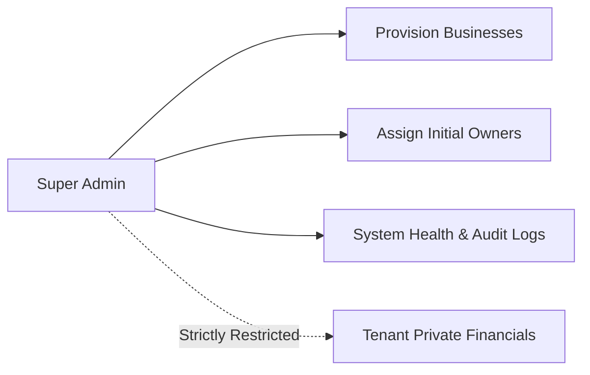

# User Personas Specification — BusinessHub SaaS

This document establishes the user personas for **BusinessHub SaaS**. Access control and capabilities in the system are governed strictly by validated server-side permissions attached to a user's active tenant membership, rather than informal job titles.

---

## 1. Platform Super Admin

- **Archetype**: Platform Systems Administrator / SaaS Operator.
- **Goals**: Ensure platform uptime, provision tenant organizations reliably, resolve account lockout issues, and maintain system security.
- **Responsibilities**:
  - Provision new business tenants upon commercial agreement.
  - Assign the initial Primary Business Owner and dispatch activation links.
  - Enforce global system settings and inspect platform-level error/audit logs.
  - Suspend or archive delinquent/compromised tenants.
- **Allowed Actions**:
  - `system:business:create`, `system:business:suspend`, `system:business:archive`.
  - `system:owner:assign`, `system:invitation:reissue`.
  - View aggregate platform statistics (total tenants, total active users).
  - Access system audit logs and diagnostic health checks.
- **Restricted Actions**:
  - Cannot view, export, or modify confidential business financial ledgers, customer lists, or proprietary recipes without explicit audited diagnostic impersonation.
  - Cannot participate in tenant operational workflows (creating batches, recording harvests).
- **Typical Workflow**: Receives new client signup -> Navigates to Platform Admin Console -> Inputs business name, slug, max owner limit, and owner email -> Dispatches activation invite -> Monitors tenant setup completion status.
- **Dashboard Information**: Total businesses, active vs. pending setups, system error rate, background job status, critical security audit events.

---

## 2. Primary Business Owner

- **Archetype**: Managing Director / Lead Agricultural Entrepreneur (e.g., "Kasun", Co-Founder).
- **Goals**: Oversee full company profitability, govern partner equity, enforce expense controls, ensure smooth production cycles, and manage team access.
- **Responsibilities**:
  - Manage company profile, legal details, and operational configurations.
  - Invite co-owners (subject to the 1–10 owner limit) and operational staff.
  - Approve major capital expenses and partner drawings.
  - Authorize closed-period profit distribution calculations.
- **Allowed Actions**:
  - Full administrative access across all tenant modules (`tenant:*`).
  - Configure business rules, tax rates, and module toggles.
  - Manage memberships, assign roles, and revoke access.
  - Approve expenses exceeding authorization thresholds.
  - Lock accounting periods and execute profit disbursements.
- **Restricted Actions**:
  - Cannot exceed the maximum owner quota (1–10) configured for the tenant.
  - Cannot delete locked financial records from closed periods.
  - Cannot access data belonging to other businesses in the system.
- **Typical Workflow**: Logs into active business dashboard -> Reviews cash on hand and daily mushroom harvest yields -> Approves pending supplier purchase invoices -> Checks incubation room contamination metrics -> Reviews partner withdrawal request.
- **Dashboard Information**: Cash balance, month-to-date revenue vs. expenses, net operating margin, active batch status, pending approval queue, low inventory warnings.

---

## 3. Business Partner (Financial Focus)

- **Archetype**: Silent Co-Investor / Equity Partner (e.g., "Nimal", Capital Contributor).
- **Goals**: Monitor return on investment (ROI), verify accurate capital and loan tracking, review monthly financial reports, and submit periodic draw requests.
- **Responsibilities**:
  - Review financial transparency reports and profit/loss statements.
  - Audit partner capital contributions and loan interest balances.
  - Request authorized dividend or capital withdrawals.
- **Allowed Actions**:
  - Read-only access to all financial ledgers, income/expense reports, and balance sheets.
  - View capital contributions, loans, and partner equity distributions.
  - Submit partner withdrawal requests for owner approval.
  - View aggregate production reports and sales metrics.
- **Restricted Actions**:
  - Cannot edit business settings, tax settings, or member roles.
  - Cannot invite or remove users.
  - Cannot create or modify daily farm operational records (batches, watering logs).
  - Cannot approve their own withdrawal requests without co-owner sign-off.
- **Typical Workflow**: Logs in bi-weekly -> Views financial summary dashboard -> Inspects profit-sharing ledger for the current quarter -> Downloads monthly P&L PDF report.
- **Dashboard Information**: Equity balance, capital contribution history, partner loan repayment schedule, current period profit allocation estimate, company cash position.

---

## 4. Business Partner (Operational Focus)

- **Archetype**: Farm Operations Partner / Production Manager (e.g., "Dilani", Operating Partner).
- **Goals**: Maximize biological yield, maintain high substrate sterilization standards, prevent contamination outbreaks, and manage wholesale supply orders.
- **Responsibilities**:
  - Oversee substrate preparation, autoclaving, inoculation, and incubation cycles.
  - Supervise cultivation staff and allocate daily room tasks.
  - Manage customer orders, deliveries, and packaging materials inventory.
- **Allowed Actions**:
  - Full management of the Mushroom Production Module (`mushroom:*`).
  - Full management of Products, Inventory, Suppliers, and Orders (`inventory:*`, `sales:*`).
  - Log operational expenses (fuel, substrate, labor) subject to owner approval thresholds.
  - View operational dashboards and batch yield analytics.
- **Restricted Actions**:
  - Cannot view other partners' confidential capital balances or loan agreements.
  - Cannot modify company ownership shares or calculate profit-sharing distributions.
  - Cannot alter tenant billing or platform settings.
- **Typical Workflow**: Morning check-in on fruiting chamber humidity -> Reviews mushroom batches ready for Flush 1 -> Assigns harvesting tasks to staff -> Logs afternoon packaging and bulk sales to wholesale distributors.
- **Dashboard Information**: Active batches by phase, daily fresh harvest kg, room temperature/humidity metrics, contamination rate %, pending customer orders.

---

## 5. Cultivation Technician / Employee

- **Archetype**: Production Technician / Greenhouse Staff (e.g., "Kamal", Farm Specialist).
- **Goals**: Execute daily production tasks quickly without administrative overhead; record accurate weights, bags, and room readings on mobile or tablet.
- **Responsibilities**:
  - Mix substrate according to formulation recipes.
  - Log bag counts, sterilization batches, and inoculation details.
  - Record daily watering, climate readings, and harvest yields.
  - Report contaminated bags immediately for quarantine.
- **Allowed Actions**:
  - Create and update task logs, watering logs, and harvest flush logs (`mushroom:harvest:create`, `mushroom:activity:log`).
  - Mark contaminated bags discarded with reason codes.
  - View assigned daily operational tasks.
- **Restricted Actions**:
  - Strictly barred from all company financial data, customer pricing, sales invoices, and partner records.
  - Cannot invite users, delete batches, or alter inventory unit costs.
  - Cannot export business records.
- **Typical Workflow**: Opens mobile browser on farm tablet -> Views "Today's Harvesting Tasks" -> Enters harvest weight (kg) and bag count for Chamber 2 -> Logs 3 bags contaminated with green mold -> Submits task log.
- **Dashboard Information**: Today's task list, active chambers assigned to user, daily harvest counter, simple quick-log action buttons.

---

## 6. External Auditor / Accountant (Read-Only)

- **Archetype**: Chartered Accountant / Tax Auditor (e.g., "Suresh", Independent Auditor).
- **Goals**: Verify bookkeeping accuracy, reconcile bank statements, review receipt attachments, and extract financial ledgers for tax compliance.
- **Responsibilities**:
  - Audit journal entries, capital contributions, and loan schedules.
  - Validate invoice tax calculations.
- **Allowed Actions**:
  - Read-only access to Finance, Sales, Purchases, Inventory valuations, and Audit Logs.
  - Export CSV/Excel reports of transactions, general ledgers, and trial balances.
- **Restricted Actions**:
  - Zero mutation rights: cannot create, edit, approve, or delete any record.
  - Cannot access operational recipes, batch notes, or employee personal data.
- **Typical Workflow**: Logs in during tax filing period -> Selects date range -> Reviews income and expense ledgers -> Exports reconciled transaction summary.
- **Dashboard Information**: General ledger balances, accounts payable/receivable, tax summary, audit log activity.
